# ThumperTalk《Dyno data》帖子技术参考
## —— Shim Stack 调校与阻尼力曲线形状控制 (Dyno data – and what it tells us about how to tune a shim stack and control the shape of the damping force curve)

> **文档性质**: 论坛帖子内容的技术转存与整理,供 `ShimTuner` 项目参考使用。
> **原帖地址**: https://www.thumpertalk.com/forums/topic/1124437-dyno-data-–and-what-it-tells-us-about-how-to-tune-a-shim-stack-and-control-the-shape-of-the-damping-force-curve/
> **发帖人 (OP)**: `Clicked` (共 213 帖,约占全帖正文 74%)。帖子共 23 页、451 帖(OP+450 回复),时间跨度 2015-02 起持续多年。
> **整理原则**: 以 OP (Clicked) 的数据、分析、结论为主线;其他用户(如 Kyle Tarry、mog、harrperf、DEATH_INC. 等)的关键讨论以「讨论注记」形式保留,便于区分**原始数据/结论**与**论坛争论中的观点意见**。
> **图片说明**: 原帖中的公式、几何图、FEA 网格/曲线、dyno 曲线均为图片。本文档已将全部可用图片下载至 `images/` 目录(存档于 `images_raw/`,其中 1 张原图因源站失效缺失,见附录 C),并在正文对应位置嵌入。

---

## 目录

1. [帖子概览与数据来源](#1-帖子概览与数据来源)
2. [阻尼力曲线基础框架](#2-阻尼力曲线基础框架)
3. [Shim Factor 与 Almen-Laszlo 方程](#3-shim-factor-与-almen-laszlo-方程)
4. [Tapered Stack Shim Factor (tsf) 与堆叠刚度估计](#4-tapered-stack-shim-factor-tsf-与堆叠刚度估计)
5. [试验一:用 Dyno 检验 Shim Factor(14x40.2 vs 4x40.3)](#5-试验一用-dyno-检验-shim-factor14x402-vs-4x403)
6. [垫片变形物理:shim 不是 Belleville 弹簧](#6-垫片变形物理shim-不是-belleville-弹簧)
7. [堆叠刚度的测量方法(四种)](#7-堆叠刚度的测量方法四种)
8. [Shim Factor 为什么失效(四种理论)](#8-shim-factor-为什么失效四种理论)
9. [低速栈/高速栈独立性检验(Dyno 证据)](#9-低速栈高速栈独立性检验dyno-证据)
10. [Crossover 四种样式(核心章节)](#10-crossover-四种样式核心章节)
11. [直堆 vs 锥形堆(Straight vs Tapered)](#11-直堆-vs-锥形堆straight-vs-tapered)
12. [阀口几何(Valve Port Geometry)](#12-阀口几何valve-port-geometry)
13. [预载与 Ring Shim](#13-预载与-ring-shim)
14. [怎样改变阻尼力曲线形状(OP 总结)](#14-怎样改变阻尼力曲线形状op-总结)
15. [压力平衡、空化、气体力与油液(系统级特性)](#15-压力平衡空化气体力与油液系统级特性)
16. [Dyno 测量不确定度与统计](#16-dyno-测量不确定度与统计)
17. [「Webology」定理真伪总表](#17-webology-定理真伪总表)
18. [对 ShimTuner 项目的要点映射](#18-对-shimtuner-项目的要点映射)
- [附录 A:数据来源与原始链接](#附录-a数据来源与原始链接)
- [附录 B:术语表](#附录-b术语表)
- [附录 C:图片清单与缺失说明](#附录-c图片清单与缺失说明)

---

## 1. 帖子概览与数据来源

原帖的目的是收集与评估 ThumperTalk 论坛上现有的 shock dyno 数据,据此回答:

- 如何用 shim factor 评价一个 shim stack?
- shim factor 与 dyno 实测阻尼力之间有关系吗?
- 不同样式 crossover 的行为;
- 改变高速栈对阻尼的影响;
- **如何控制阻尼力曲线的形状**;
- 直堆与锥形堆的阻尼对比。

### 1.1 帖子引用的 dyno 数据源

| 来源 | 设备/方法 | 特点 |
|---|---|---|
| **MXScandinavia** | Roehrig 曲柄 dyno + 手指压力机(finger press)+ 对照 Ohlins 工厂数据 | 系列最完整的"基础问题"试验;finger press 可测到 7h/t 升程(≈38 m/s 轮速当量) |
| **John Curea (MxTech dyno)** | PVP 曲柄 dyno | yz250 后减震、Dogger 的 crf450r 回弹;轴径 16/18mm 对比 |
| **Valving Logic (VL)** | PVP dyno + FEA | rmz250 / kxf450 / rmz450 / rm85 / kxf250 等大量配置;含 backer limit 测试 |
| **Push Ind. (Darren)** | EMA dyno | 单冲程采集,高速数据;yzf450 示例 |
| **Kawamaha** | 液压 dyno(高压油泵直注阀体) | 直接测量压差;无气体力/多回路混杂;还能测回弹高速视频 |
| **Ohlins 工厂** | 工厂台架 | 17 个压缩/回弹配置,轴速到 120 in/s(几乎所有民用 dyno 达不到的高速) |

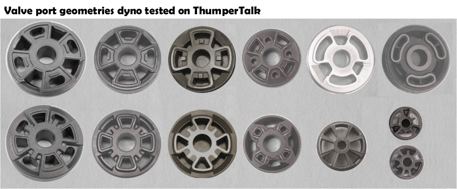
*数据覆盖的各种阀体(自由流动/非自由流动两类)*

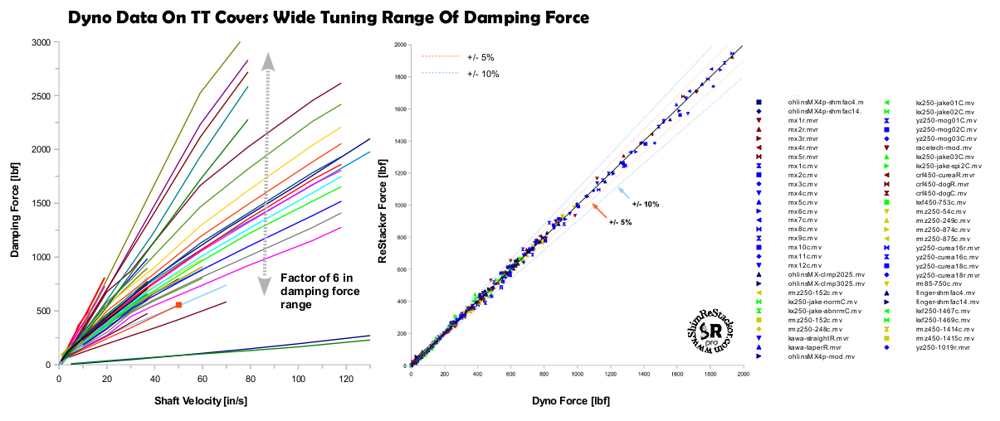
*Dyno 阻尼力覆盖约 6 倍调校范围;crf/kx/rmz/yz 后减震,轴速到 120 in/s*

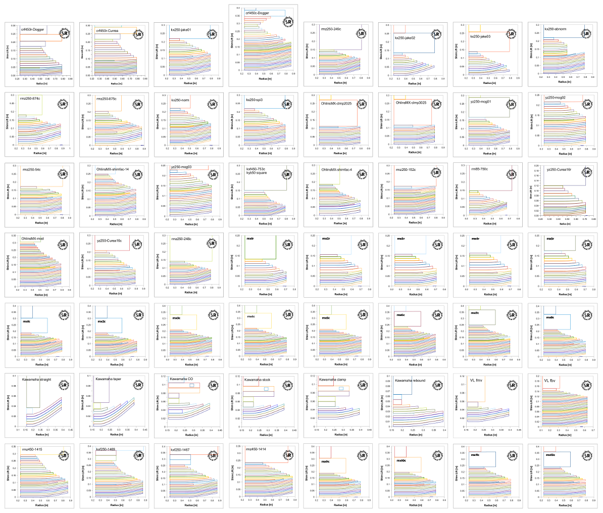
*数据覆盖的各类 shim stack 配置*

### 1.2 OP 的分析方法论

OP 反复强调 **「理论 + 试验 + 分析」三足鼎立**:

> "Data is needed to validate theory, theory to develop analysis tools and analysis tools to understand the data. Working together those three create a sum that is greater than the parts."
> (数据验证理论,理论发展分析工具,分析工具理解数据。三者结合大于部分之和。)

- 分析工具主要为 **ReStackor**(OP 澄清:ReStackor 不使用 Belleville 公式,而是用 FEA 计算堆叠挠度;典型设置:shim 摩擦系数 cf.stk = 1.0;Ohlins 19 cSt 油、SpGr 0.85、溶解气体积分数 xLsat ≈ 0.015)。
- **速度换算**(机械臂比约 3:1):轴速 120 in/s ≈ 轮速 360 in/s ≈ 4 英寸凸块 50 mph ≈ 8 英寸凸块 30 mph。极端:轴速 500 in/s ≈ 轮速 1500 in/s(38 m/s)≈ 7 英寸凸块 140 mph。

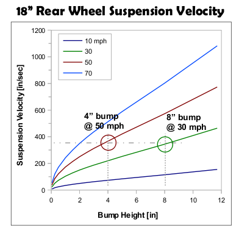

---

## 2. 阻尼力曲线基础框架

阻尼力曲线形状按"比线性更快/更慢增长"分三类(以 $F_{damp} = V_{shaft}^{pow}\times 20^{pow}$ 生成示意,并校正在 20 in/s 处相等):

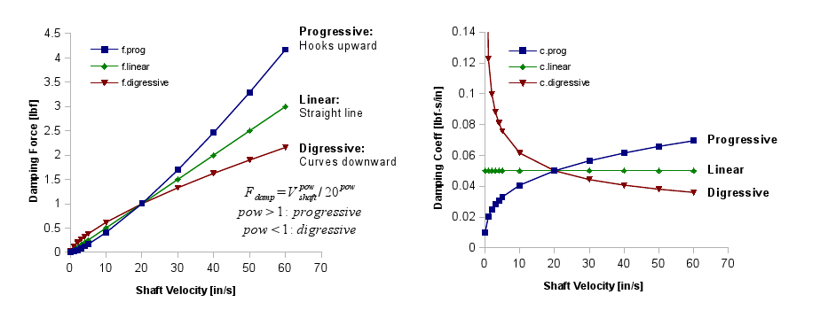

- **线型 Linear**(pow = 1):阻尼力随轴速直线增长;阻尼系数恒定。
- **渐进型 Progressive**(pow > 1):上钩,高速段更硬;阻尼系数随速度上升。
- **递减型 Digressive**(pow < 1):下弯,高速段更软;阻尼系数随速度下降。

**工程背景(OP 观点)**:
- 减震器被有意调成**递减型**:低速需要重阻尼控制车身(chassis),高速需要轻阻尼让车轮浮过障碍。曲线上两段之间的"膝盖"(knee)就是过渡点;
- 低速段(0~5 in/s 左右)由 **clicker 泄流孔**主导——固定节流孔流量特性使低速段天然是**渐进型**;5 in/s 以上 stack 开启后变为递减型;
- 用**阻尼系数 (damping coefficient, lbf·s/in) 曲线**判读形状最方便:系数随速度升→渐进;降→递减;恒定→线型;
- 越野场景下 MX 车偏渐进(硬碰硬"跳过去"),林道/耐力车需要递减(吸方边、又不让车身摇摆)。

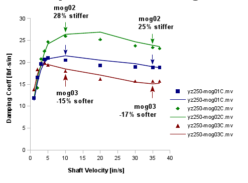

---

## 3. Shim Factor 与 Almen-Laszlo 方程

### 3.1 来源:Belleville 弹簧方程

Shim factor 理论源自 **Almen 与 Laszlo 1936 年**为 GM 开发的 Belleville 弹簧(碟簧)方程(见 Schnorr Handbook)。单只垫片的刚度:

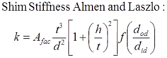

$$k = A_{fac}\,\frac{t^3}{d^2}\left[1+\left(\frac{h}{t}\right)^2\right] f\!\left(\frac{d_{od}}{d_{id}}\right)$$

其中 $t$ 厚度,$h$ 边缘升程,$d_{od}/d_{id}$ 外径/内径,$f(\cdot)$ 为直径比非线性因子,$A_{fac}$ 材料系数。**刚度对 OD、ID、边缘升程、厚度均有复杂依赖**。

### 3.2 Shim factor 的简化

假设堆叠中所有垫片:同夹紧直径、同直径、同边缘升程比、同材料,则两只垫片的刚度比化简为**厚度三次方**:

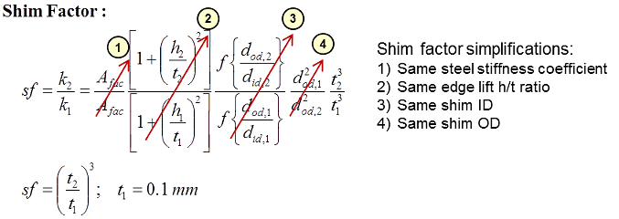

$$sf=\frac{k_2}{k_1}=\frac{1+(h_2/t_2)^2}{1+(h_1/t_1)^2}\cdot\frac{f(d_{od,2}/d_{id,2})}{f(d_{od,1}/d_{id,1})}\cdot\frac{d_{id,1}^2}{d_{id,2}^2}\cdot\frac{t_2^3}{t_1^3}
\quad\xrightarrow{\text{4项简化}}\quad
sf=\left(\frac{t_2}{t_1}\right)^3,\quad t_1=0.1\,\mathrm{mm}$$

四项简化条件:① 同钢种系数;② 同 h/t 边缘升程比;③ 同 shim ID;④ 同 shim OD。

以 0.1 mm 参考垫片为基准的 shim factor 表(**与 MX-Tech 网站数值一致**):

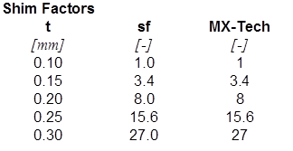

| t [mm] | 0.10 | 0.15 | 0.20 | 0.25 | 0.30 |
|---|---|---|---|---|---|
| sf [-] | 1.0 | 3.4 | 8.0 | 15.6 | 27.0 |
| MX-Tech | 1 | 3.4 | 8 | 15.6 | 27 |

整堆的 shim factor 为各片之和,如"14 片 40.2 面片" = 14×8 = **112**。

### 3.3 局限(OP 强调)

1. **边缘升程条件矛盾**:shim factor 要求两堆的 $h/t$ 比相同——即厚度 2 倍的垫片要抬起 2 倍高度才"等效"。但物理上抬得越高流速面积越大、阻尼越低,所谓"等效"在流量意义上不成立;实际比较时应取相同边缘升程 $h_1 = h_2$。
2. **非线性被忽略**:Almen-Laszlo 的边缘升程比 $h/t$ 与直径比 $d_{od}/d_{id}$ 定义了垫片的非线性刚度效应;shim factor 全部忽略,只用厚度三次方。

---

## 4. Tapered Stack Shim Factor (tsf) 与堆叠刚度估计

### 4.1 推导(OP 给出)

Almen-Laszlo 方程可以反过来用:**夹紧区内的垫片不弯曲**,因此要扣除夹紧部分;同时把"堆叠边缘"的升程折算到"阀口边缘"(damping force 的有效计量位置)。

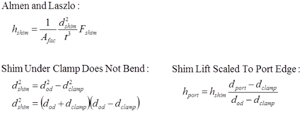

$$h_{shim}=\frac{1}{A_{fac}}\frac{d_{shim}^2}{t^3}F_{shim},\qquad
d_{shim}^2=d_{od}^2-d_{clamp}^2=(d_{od}+d_{clamp})(d_{od}-d_{clamp})$$

$$h_{port}=h_{shim}\frac{d_{port}-d_{clamp}}{d_{od}-d_{clamp}}$$

代入得"堆叠弹簧常数":

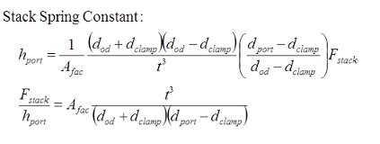

$$h_{port}=\frac{1}{A_{fac}}\frac{(d_{od}+d_{clamp})(d_{od}-d_{clamp})}{t^3}\cdot\frac{d_{port}-d_{clamp}}{d_{od}-d_{clamp}}F_{stack}
\;\;\Rightarrow\;\;
\frac{F_{stack}}{h_{port}}=A_{fac}\frac{t^3}{(d_{od}+d_{clamp})(d_{port}-d_{clamp})}$$

对整堆求和并乘 $10^6$ 得 **Tapered Stack Shim Factor**:

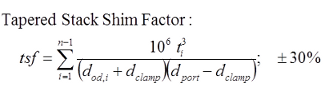

$$\boxed{\;tsf=\sum_{i=1}^{n-1}\frac{10^6\,t_i^3}{(d_{od,i}+d_{clamp})(d_{port}-d_{clamp})}\;}\qquad \pm30\%$$

> OP 原话:"The above equation does not work very well. errors are in the +/- 30% range ... Hopefully someone will post a better method......."

### 4.2 校准为刚度 (lbf/in)

用 MXScandinavia 的 finger press 数据定标:**tsf × 40 ≈ 堆叠弹簧常数 (lbf/in)**(14x40.2 堆实测约 **9,500 lbf/in**;4x40.3 堆用 35 居中更好,文档统一取 40)。修订后的形式(mm 混单位):

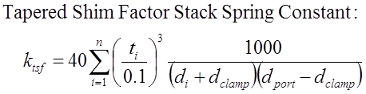

$$k_{tsf}=40\sum_{i=1}^{n}\left(\frac{t_i}{0.1}\right)^3\frac{1000}{(d_i+d_{clamp})(d_{port}-d_{clamp})}\quad[\mathrm{lbf/in}]$$

用这个式子在 56 次 dyno 数据上回归:**误差 ±30%,且残差无系统性偏向**(见 §16)。

### 4.3 应用示例

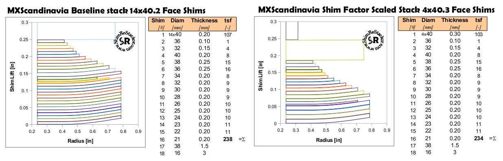

- 基线 14x40.2 面片堆:tsf ≈ **241**(图中 Σ=238);替代 4x40.3 面片堆:tsf ≈ **237**(图中 Σ=234)→ 理论上仅 2% 软。而 dyno 实测差 8%,finger press 高升程差 20%(见 §5)。

---

## 5. 试验一:用 Dyno 检验 Shim Factor(14x40.2 vs 4x40.3)

### 5.1 试验设计(MXScandinavia)

把 **14 片 0.2mm 面片**(40.2)用 shim factor 换算成"等效"的 **4 片 0.3mm 面片**(40.3):

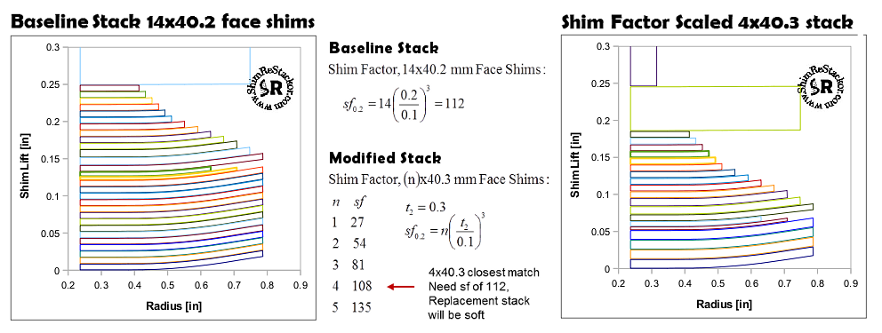

- 基线 sf = 14×(0.2/0.1)³ = **112**;
- 替代堆只能取 4 片(4×27=108)或 5 片(135),取 **108**(理论上软 4%);
- 计入锥形段后整堆 tsf:241 vs 237,理论上**整体软 2%**。

### 5.2 结果:Dyno 实测差 8%

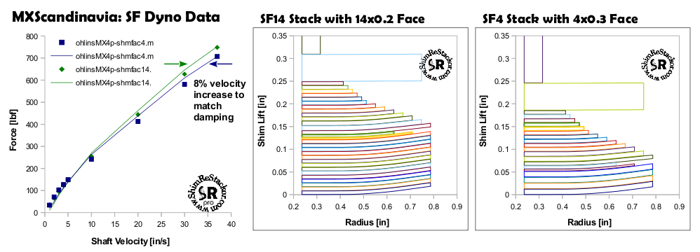

- 实测替代堆要**高 8% 轴速**才能达到相同阻尼力 → 实际软 **8%**,shim factor 把差值的量级低估了 **4 倍**;
- 8% 的轴速差 ≈ **5 clicks 泄流螺钉**(OP 给的"实感"换算参考)。

试验用 **Ohlins 四口压缩阀**(下图给出口径/端口几何参数表;后续 ReStackor 分析也基于同一配置):

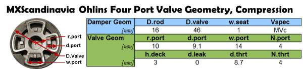

| Damper Geom | D.rod | D.valve | w.seat | Vspec |
|---|---|---|---|---|
| [mm] | 16 | 46 | 1 | MVc |

| Valve Geom | r.port | d.port | w.port | N.port |
|---|---|---|---|---|
| [mm] | 10 | 9.1 | 14 | 4 |

|  | h.deck | d.leak | d.thrt | N.thrt |
|---|---|---|---|---|
| [mm] | 3 | 0 | 8.7 | 4 |

### 5.3 五重交叉验证(OP 强调的证据链)

1. MXScandinavia dyno 与 **Ohlins 工厂 dyno** 在 120 in/s 内完全吻合;
2. FEA 计算与两者吻合 → 堆叠挠度计算可信;

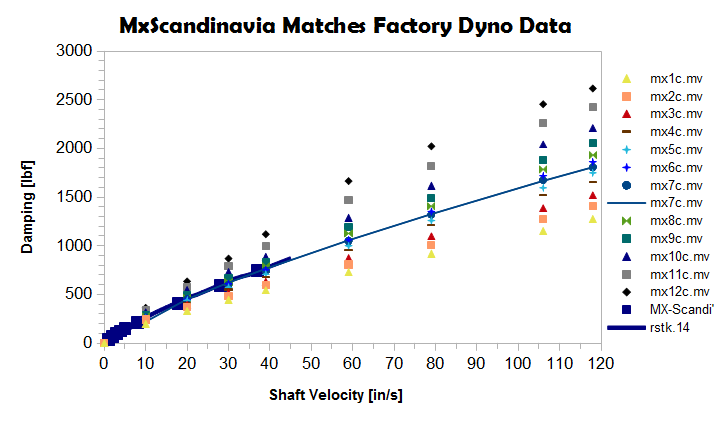

3. **finger press** 直接测堆叠刚度,与 FEA/dyno 一致(在 dyno 覆盖的低升程段);

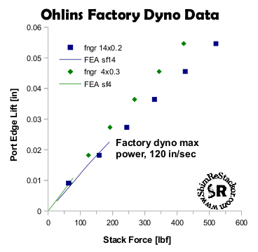

4. finger press 延伸到 **7h/t** 升程(等效轮速 38 m/s、4 英寸凸块 200 mph),FEA 同样吻合;
5. 结论:**五组独立测量下,两堆在高升程真实差 20%**(1.2 mm 升程时 21% 软),shim factor 在低升程也错了 4 倍。

> **【讨论注记】** 用户 Kyle Tarry 提出统计学质疑:2%/8% 差异相对 dyno 与手工测量的重复性可能不显著,建议做显著性检验;OP 回应:数据经三个独立来源交叉验证,且该推力并非结论核心;真正显著的是高升程 20% 差与刚度曲线的形状。**文档以 OP 的交叉验证证据链为主,统计学质疑仅作保留意见记录。**

---

## 6. 垫片变形物理:shim 不是 Belleville 弹簧

### 6.1 两种理论的冲突

- **Belleville 理论**:碟簧被压平过程中,外缘被迫**拉伸**到更大直径,达到某点发生"oil canning"翻折成 S 形 → 刚度非线性上升(Almen-Laszlo 能预测 oil-canning 的几何组合);

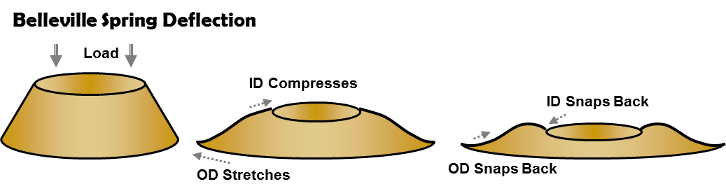

- **平垫片弯曲**:相反过程——平面垫片弯成锥面时,**外径必须变小**;垫片"讨厌"这个,于是边缘**起皱(wrinkling)**成波浪形,保住原来的周长(咖啡滤纸折成锥形的原理);

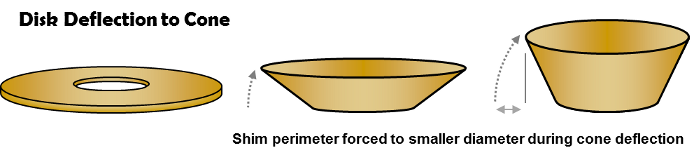
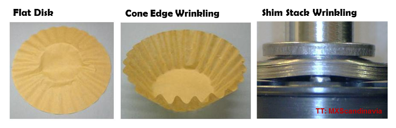

- 波浪形挠度大量释放内应力 → 实际垫片堆的刚度**远没有 Belleville 预测的那么非线性**。

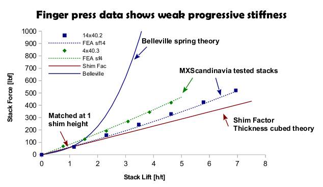

### 6.2 实测:7h/t 内接近线性

MXScandinavia finger press 数据(加 Ohlins 工厂 dyno、MXScandinavia dyno、FEA 共四路数据)显示:边缘升程到 **7h/t** 无"突然变硬",只有**轻微的渐进**(slightly progressive);越薄的垫片在高升程略更硬(h/t 内应变大,Almen-Laszlo 中 $1+(h/t)^2$ 项方向正确但幅度小)。

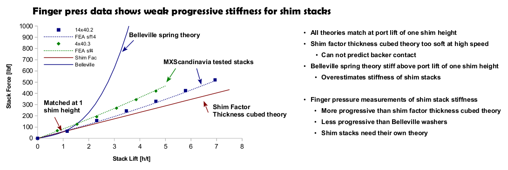

- 两个 shim-factor 等效堆的**渐进速率不同**:14x40.2 堆更快变硬 → 1h/t 处差 8%,7h/t 处差 20%;
- 特例:**压缩调节器(compression adjuster)阀片**四周全部受压,缺少造成波浪的周向差异力,可能真的呈 Belleville 式变硬——但其升程远小于非线性显著范围,影响有限。

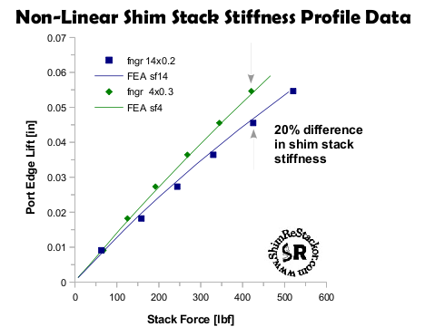

---

## 7. 堆叠刚度的测量方法(四种)

### 7.1 Finger press(手指压力机)

钢棒穿过阀口直接顶起堆叠,逐点测量"力-升程"。MXScandinavia 的装置:

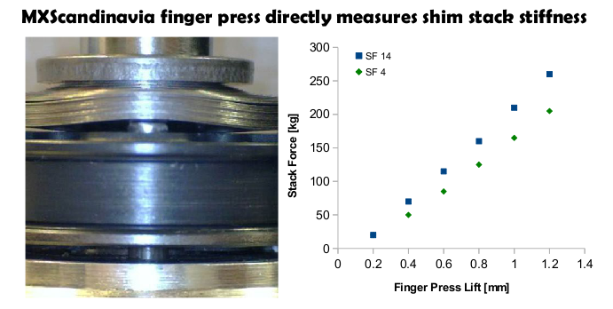
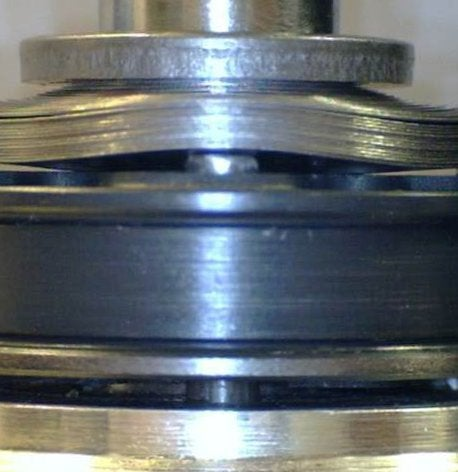

用数据前需要**三个修正**(OP 归纳):

1. **零点偏置**:零力时示数已有升程(垫片未贴合)→ 先做 zero offset;阀面做了研磨打磨(lapped flat)后应零力=零升程;

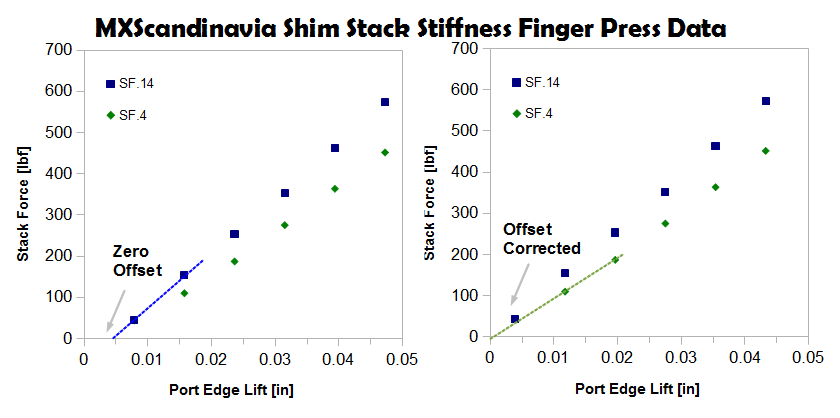

2. **测量位置折算**:finger press 在**阀口射流中心线**处测升程,而阻尼力关心**阀口边缘**;按几何折算,**阀口边缘升程比 finger press 位置大 17%**;

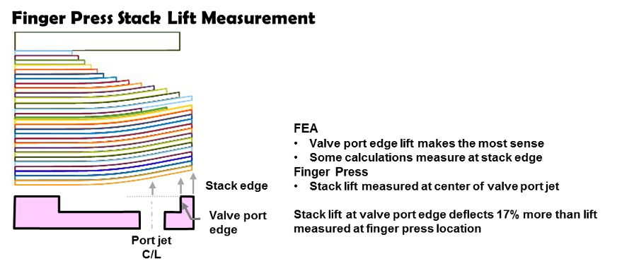

3. **载荷性质折算**:finger press 是**集中点载**,油压是**分布面载**;折算到等效作用点后,**finger press 力 ≈ 油压作用力的 85%**(仅对该阀口几何成立)。

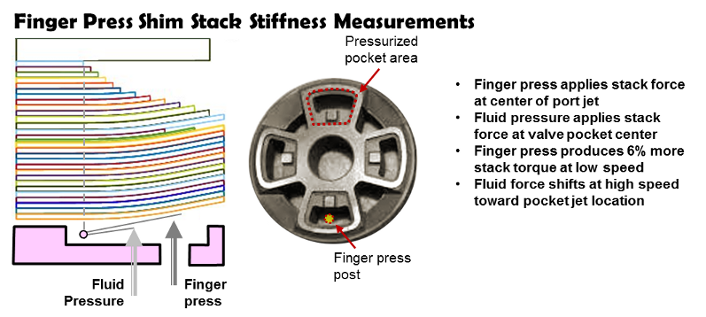

修正后的完整结果:14x40.2 vs 4x40.3 堆,升程曲线由低到高逐渐分离,**高升程差 20-21%**:

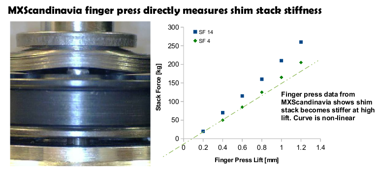

> **讨论注记(OP 提出)**:堆叠弯曲呈**波状**("wave shape");若用 1、2、3、4 个手指测试,刚度会不同(侧面先被抬起,波形交叠后整体抬起);波的作用未包含在 shim factor 中。

### 7.2 高速极限验证

用 FEA 反推:达到 7h/t 升程需要 **500 in/s 轴速**,阻尼力约 5 吨;曲柄 dyno 无法在这个量级维持(700 hp、油几秒内汽化发泡),只有 EMA dyno 单冲程能取数。finger press 数据覆盖远超常规 dyno 的极限,显示**没有异常非线性**:

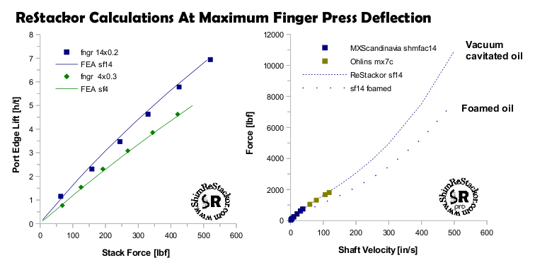

### 7.3 Backer limit(挡板法)

在堆叠上方放硬挡板,用 dyno 找出"堆叠打到挡板"的轴速——**原位、用真实油压变形、无假设**:

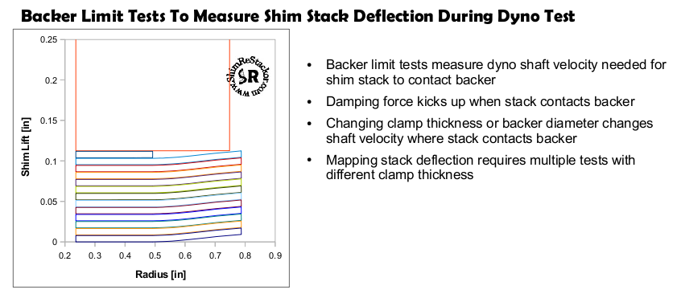

- MXScandinavia ct2025(0.2mm clamp)/ ct3025(0.3mm clamp)试验:薄的 ct2025 在 **30~35 in/s** 间打到 backer,厚的没有:

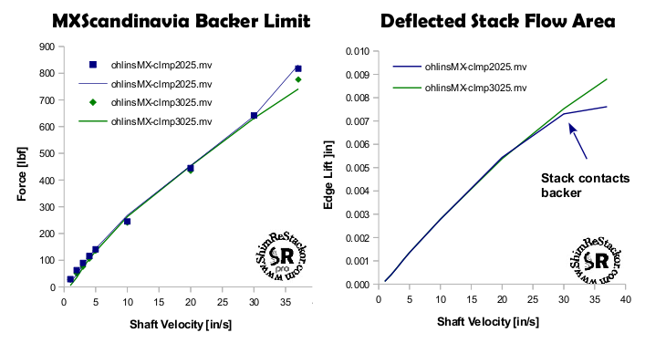

- Valving Logic 的 rmz250-152:KYB 46 阀,FEA 预计 **≈53 in/s** 触板;PVP 数据只取 50/60 in/s 两个离散点,实际"没那么硬"地触板:

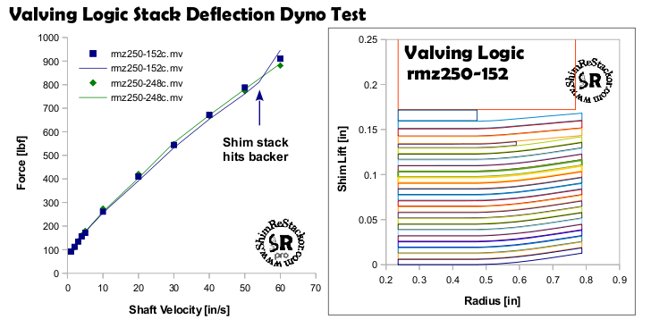

### 7.4 FEA 计算

FEA 给出"堆叠挠度-力"曲线;要换算阻尼力还需沿阀口周长积分出**流量面积**(见 §10.3)。OP 的立场:三种测量(finger press、backer limit、FEA/dyno)互相印证,各有适用范围。

---

## 8. Shim Factor 为什么失效(四种理论)

14x40.2(高堆)比 shim factor 预期更硬;**第二组试验**(把锥形段的 0.2mm 垫片换成 0.15mm 对片)中,理论上更软的堆却 dyno 测得**硬 3%**,方向相反。OP 汇总了四种解释:

### 8.1 Fulcrum(支点)效应

每增加一片垫片都会推高"夹紧支点"的等效直径;把夹紧支点投影穿过整个堆叠到面片,面片变成有更大有效夹紧直径 → 更硬。堆越高越硬:

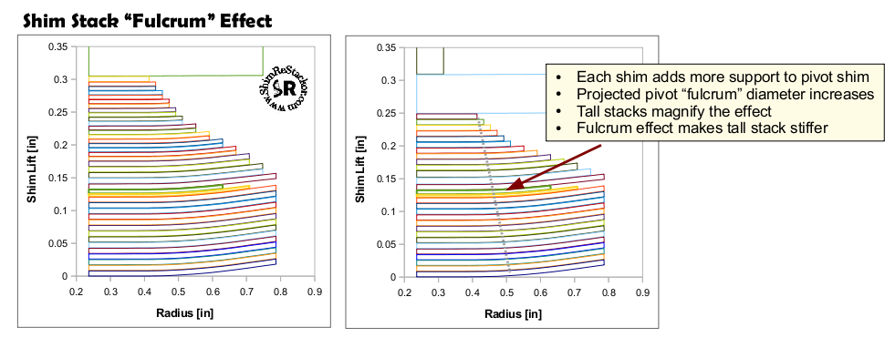

- 替换 9 片 0.2 为"对片 0.15"使堆高 +50%(对片叠起)→ 大 fulcrum → 更硬;
- OP 疑问:支点随升程如何移动?若随升程内移应"越抬越软"(digressive),与 finger press 数据相反。

### 8.2 内部应变(internal strain)

Almen-Laszlo 的 $h/t$ 项:相同边缘升程下,薄片 h/t 更大、内应变更大 → **薄片(高堆)更硬**。

### 8.3 垫片摩擦(friction)

- Bath 大学 Darling 教授 / Aerospace Corp / Schnorr 手册:**摩擦可使 Belleville 式堆叠刚度增加 15~30%**;
- Darling 数据:**抬起(push open)比放回(lower)刚度约高 17%**;浸油可显著减小该差;
- 14x40.2 堆片数/接触面积更多 → 摩擦更大 → 部分解释 20% 差。

### 8.4 Stacked Bowl(叠碗)理论

同直径的一摞碗装不进彼此;要叠上,每只碗的直径必须比下面小一点——垫片堆同理:**顶部垫片被迫围绕更小的半径弯曲**,越高的堆越硬,且升程越大半径越尖 → **渐进变硬**:

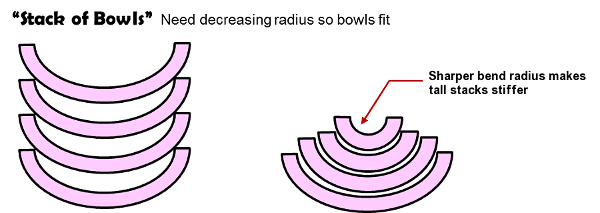

### 8.5 结论:"高堆更硬"(带例外)

> 四种理论对四组试验数据的拟合各有胜负。总体规律:
> - **高堆的薄片堆 >低堆的厚片堆**:True(fulcrum/叠碗/内应变/摩擦+数据支持);
> - **高堆"总是"更硬**:**False**——第三组试验(高速段 5×0.25→0.20,堆高仅变 5%)中,"高堆更硬"没有出现;堆高变化 ~5% 不足以触发该效应。规则"有时成立"=对调校无用。

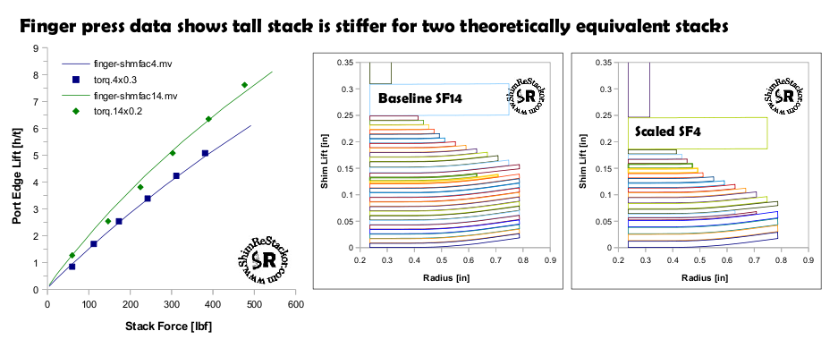

---

## 9. 低速栈/高速栈独立性检验(Dyno 证据)

传统口诀:低速堆管低速阻尼、高速堆管高速阻尼。OP 用三组 dyno 测试证明其**对多数 real-stack 不成立**:

### 9.1 软化高速栈(mx3c:5×0.25→5×0.20)

- shim factor/tsf 预测:高速段软 30%,整体软 18%;
- dyno:整体只软 **9%,且处处均匀地软**(形状不变);

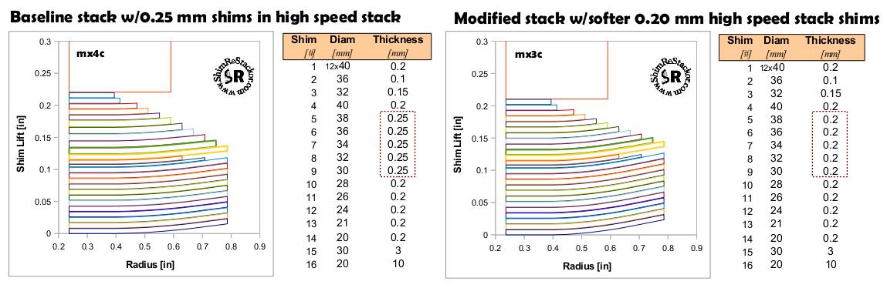
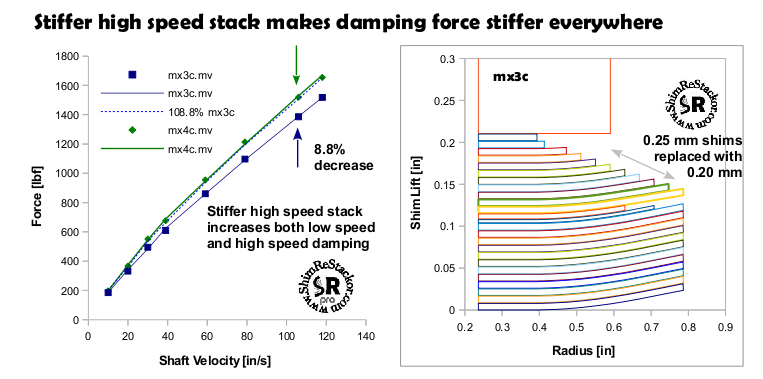

### 9.2 硬化高速栈(mx9c:4×0.20→4×0.25)

- 预测:高速段 +40%,整体 +16%;
- dyno:**处处变硬**,无"只硬在高速";FEA 也预测只有 ~10% 流量面积差(对应 10% 轴速等效差);

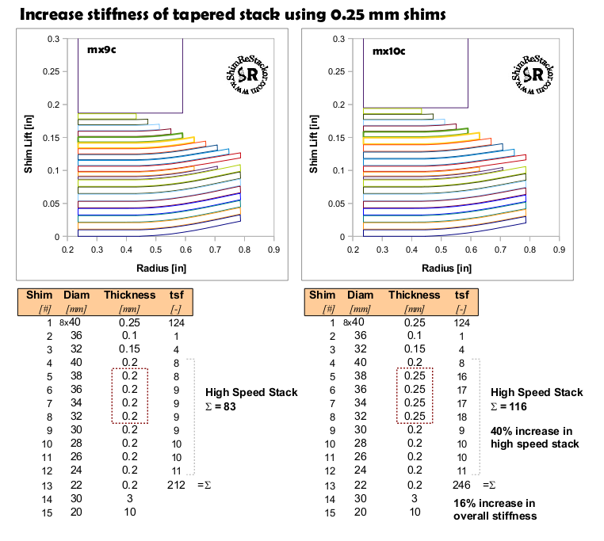
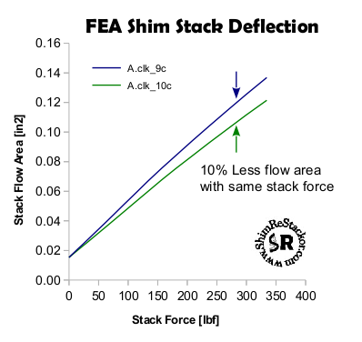
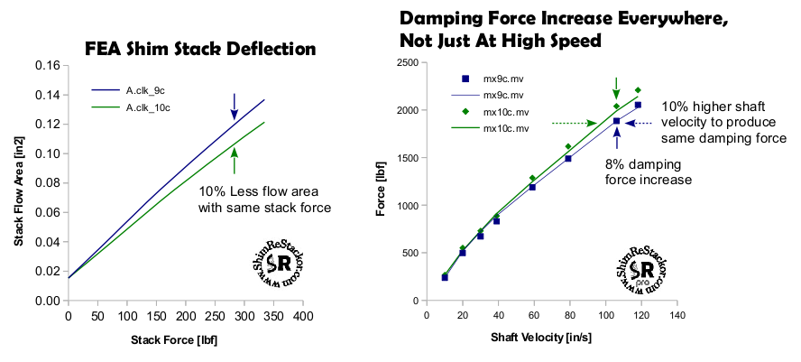

### 9.3 mog 堆叠(mog01/02/03:加面片、改 clamp)

按 webology 走"低速堆加片→只加低速;clamp 变小→只减高速"的设计:

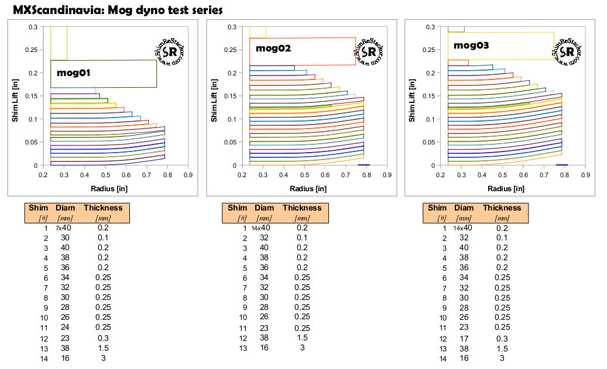

- mog02(+7 面片,去 24.25):预测低速 +2~17%、高速回落;**dyno:10 in/s 处 +28%,全程保持,高速 +25%**;
- mog03(17.3 clamp 替代 23):预测低速 -4~7%、高速 -12~15%;**dyno:低速 -15%,全程保持,高速 -17%**;

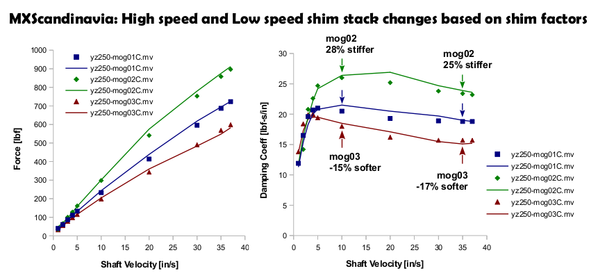
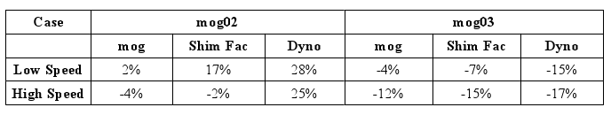

> mog 的结论(OP 引用):"…it doesn't matter which end of the stack you work with, the effects are similar for the curve."(无论改堆的哪一端,效果都是把曲线整体平移,形状角度相似。)

### 9.4 结论

- **对交互式(interactive) crossover 的堆叠:低速/高速不可独立调;**高速堆刚度、clamp 会同时影响低速(力经 crossover 传递);
- 唯一例外:**non-interactive crossover**(见 §10),它才提供"低速段-高速段"分离的调节;
- OP 名言:"Shim stack stiffness does that, damping force does not."(堆叠刚度在跨越点确有突跳,但阻尼力没有——见 §10.3。)

> **【讨论注记】** harrperf 在帖中称自己在 Ansys 上对简单堆做过 FEA,"厚度三次方规则保持得非常好",问"我漏了什么?"。OP 的回应:简单直堆确实接近三次方;失效来自**堆叠结构效应**(高堆、crossover、预载、摩擦)与**交叉耦合**——恰是这些复杂配置才是调校对象。

---

## 10. Crossover 四种样式(核心章节)

原帖 dl 数据中展示了 **4 种 crossover**:

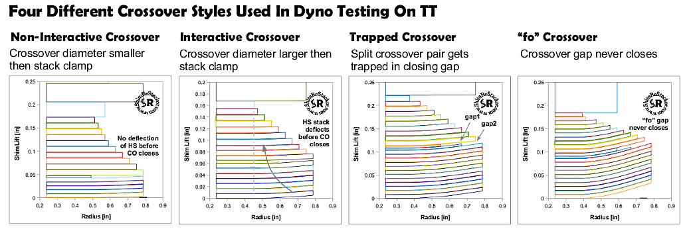

### 10.1 Non-Interactive(非交互式)

- **crossover 直径 < clamp 直径**;面片在闭合前**独立**弯曲,高速堆不参与;
- 闭合前低速软化,闭合时刚度**突跳**;是"教科书式"的 crossover 行为,也是**唯一**能做到"低速段独立调校"的样式;
- 案例:Dogger crf450r 回弹(Curea), 4 片面片太软 → 低速几乎无阻尼(knee 消失,曲线近乎直线);

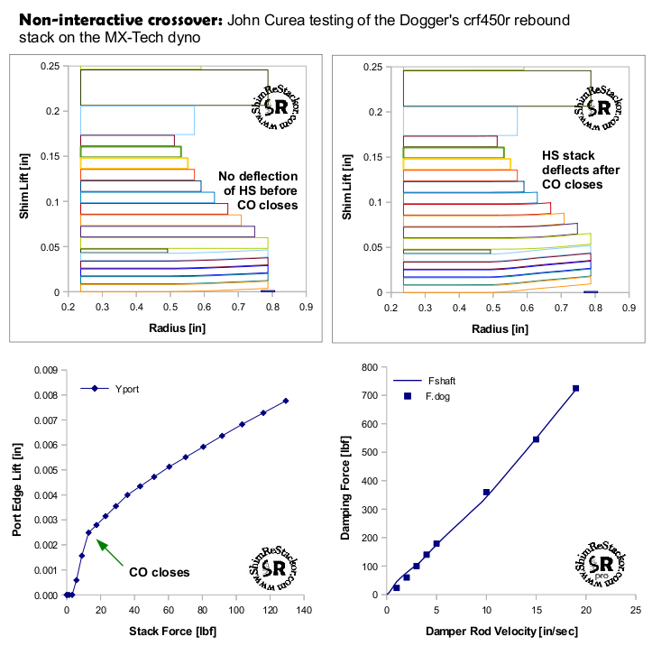

> 案例深化:Curea 为 270 lb 车手改堆——**加 5 面片(提高低速)+ 同时软化高速堆**(补偿面片增量)后,高速净 +10%,低速 +40%(5 in/s),且**跨点从 3 in/s 移到 5 in/s、闭合"拐点"被磨平**。这说明:要改变形状必须**同步改两处**。

### 10.2 Interactive(交互式)

- **crossover 直径 > clamp 直径**:面片受力有一部分**经 crossover 直接传给高速堆**;
- 高速堆在闭合前就开始弯曲 → 闭合"事件"被拉散在速度区间上 → 阻尼曲线**平滑无拐点**;引入"mid-speed"阻尼概念;
- 大 crossover 直径 = 更多力转递 = 闭合更迟;极端时高速堆与面片等速率弯曲 → 永不合拢 → 变成 "fo";
- 案例:Mog yz250 堆(MXScandinavia 测试)闭合过渡从 35 → 65 in/s 摊开:

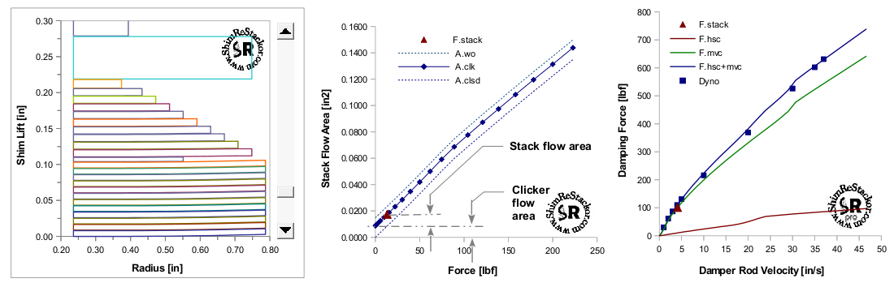

- **直径定义只是表象**:多例"直径上属于 interactive"的堆实测表现为 non-interactive(低速堆太软 / 高速堆太硬 / crossover 太厚不弯)。判断要看**堆叠内相互作用**,不能只看尺寸表:

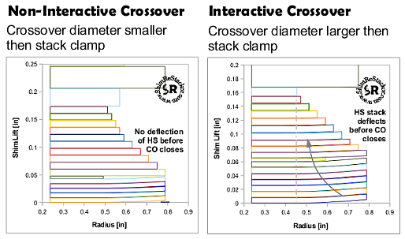

### 10.3 为什么 dyno 上看不到"闭合拐点"?(edge lift vs flow area)

- FEA 的**边缘升程**曲线在闭合处有尖突(刚度确有突跳);
- 但阻尼力由**流量面积**决定:闭合瞬间面片"贴向"高速堆(**mash out**),升程中心线几乎不变,而**阀口两侧被压开**,流量面积平滑增加;
- 加之流体"不傻":压差不足时自动回流一部分走 clicker 泄流,压力爬升被拉长——**阻尼力曲线没有拐点**;

- 这解释了"FEA 显示尖突、dyno 看不到"的争议:**看错了变量**(要看 flow area,而非 center lift)。

### 10.4 Trapped(受困式)

- 用**一对直径错开的垫片**(如 34.1 + 28.1)构成 crossover;闭合时大直径片**被夹在缝隙里**,等效 clamp 直径变大 → 堆叠**在闭合过程中反而变硬**;
- 案例:MXScandinavia Jake-Normal vs Jake01——按厚度三次方,单个 0.15 的 crossover 比 0.1 对片硬 1.7 倍,且 gap 更小,理论 Jake01 更硬;**dyno 相反**;FEA 用 trapped 机制解释了全部:

- 但**并非所有对片都会 trapped**:需要直径比率足够、上片足够薄(valving Logic rmz250-54c / kxf450-753c / rmz250-875c 三例说明"差一点就不 trapped");把 crossover 拆成对片的本意是软化 + 平滑肩部受力(避免面片在尖角上折弯),**意外后果**才是 trapped。

### 10.5 "fo"(假)式

- "fo" fur(假毛皮)的梗:**永远不合拢的 crossover**;
- 成因:crossover 直径太大、高速堆太软、或面片太硬 → 高速堆与面片同步弯曲, gap 不动,堆叠行为**退化为无 crossover 的简单锥堆**;
- 识别意义重大:**假开真闭**——dyno 覆盖范围内它"无作用",超过测试速度后闭合,阻尼曲线陡变,是"dyno 数据与路试感受对不上"的经典来源之一;

- 特例的另一面:**受困 + fo** 容易在"参数微调"中互相翻转,导致整条曲线换形——dyno 调参者的一大干扰源。

### 10.6 小结(OP 版定义)

| 样式 | 几何特征 | 行为 | 典型效果 |
|---|---|---|---|
| Non-Interactive | crossover 直径 < clamp | 面片独立,闭合点明确 | 低速软化,knee 明显;唯一可分离调校 |
| Interactive | crossover 直径 > clamp | 力转递,闭合摊开 | 低速轻度软化,过渡平滑,无拐点 |
| Trapped | 对片交叉,大径片被夹 | 闭合过程等效 clamp 增大 | **反向变硬**,设计陷阱 |
| "fo" | 直径过大/高速堆过软 | 永不合拢 | 形同虚设(测试范围内),高速后突变为另一条曲线 |

---

## 11. 直堆 vs 锥形堆(Straight vs Tapered)

三组独立 dyno 试验回答"直堆和锥堆的阻尼曲线形状有本质差别吗":

| 试验 | Shim factor 预测 | Dyno 实测 |
|---|---|---|
| MXScandinavia(Ohlins 4孔, Jake 骑行) | 直堆硬 4% | **几乎无差**;细节:锥堆 10 in/s 处因 trapped crossover 略硬 8%,高速因锥段更软(tsf 94 vs 104)回落对齐 |
| Valving Logic(rmz250, KYB46) | 直堆软 34% | **几乎无差** |
| Kawamaha(yz250 前叉, hydraulic dyno) | 锥堆硬 59% | **相反**:锥堆软 12%(FEA 亦预测锥硬 12% — 数据成谜,OP 无解而存疑) |

- **结论(OP)**:直堆、锥堆、甚至"倒圣诞树"都无所谓——**决定阻尼的是堆叠结构在面片处产生的刚度**;只要刚度相同,阻尼曲线相同。
- 那工厂为什么用锥堆?OP 给出**鲁棒性/可靠性理论**:直堆所有垫片仅在 clamp 处一条线弯折,高升程形成**应力集中**,大冲击后可整堆屈服报废(KTM 老叉例);锥形堆把夹紧力分散、面片呈平滑弧线,疲劳寿命/抗误操作更好:

---

## 12. 阀口几何(Valve Port Geometry)

### 12.1 参数定义(ReStackor 体系,OP 详解)

- **r.port**:阀腔压力作用在 shim 上的内半径(若 clamp 覆盖 r.port,则由 clamp 决定内圆);
- **w.port**:阀座(密封带)宽度——流量从这里的径向"溢出",甩向减震筒壁;
- **d.port**:沿阀辐条(spoke)的溢出长度——面片挠度形成楔形流道,流动还要**转过 90°**,因此比 w.port 更受限;
- **d.thrt**:阀腔节流(等效直径)——大冲击时全部流量被迫过 d.thrt → **阀口"液压锁死"**,是厂家抑制冲击行程铺穿的手段;
- **h.deck**:入口高度(阀底与背向流堆第一片之间)——常见于 KTM 叉阀;delta shims 调节它比"JB 焊补 + 重新钻孔"方便;
- **d.leak**:泄漏孔。

自由流动(回弹)/非自由流动(压缩)阀的诸多实例:

- **宽 seat(如 Showa HMAS)**:小升程时流动挤过狭缝 → **粘性损失提高低速阻尼**(Fox RE:aktiv 亦用此思路对应踩踏晃动);
- 压缩调节器阀片若四周全周长排布(N.thrt×w.port ≥ 周长)则按**周向座**处理,否则是**离散口**。

### 12.2 宽口 vs 窄口:Race Tech 三孔 vs Ohlins 四孔(同堆)

webology 说"宽口一开就泄压→低速软;窄口(四孔)逐渐从侧边溢流→渐软(digressive)"。

实测:

- 低速:RT 更软(与预期一致);
- 整体:RT **反而硬 28%**(在 40 in/s);Ohlins 呈 digressive,RT 更"平"。

定量比较两种阀口(OP 给出思路):

- **口面积** ≈ w.port × d.port → 比值 **1.56**(Ohlins 大);
- **周长溢出面积** ≈ 三角形假设 → 比值 **1.27**;
- 两者相乘 = **1.98**,与实测 1.28 同向但量级偏差 → "不能简单按面积比推阻尼"。

### 12.3 波状挠度 × 阀口几何(重要机理)

面片挠度是**波浪形**且波峰对准阀口中心:

- 宽口:波只抬起阀口中部,**左右两侧被压住** → 实际通流宽度 < 名义宽度;
- 窄口(多孔):波峰对齐端口,侧面"溢出"占比更高;
- 后果:**两个堆可以有相同的中心线升程却产生不同的流量面积与阻尼**;比较不同阀口的调校必须用**流量面积**这个量,而非升程。

> 2023 年帖尾补充讨论:**2 孔阀**同样弯成波("taco"形);2/3/4 孔阀波峰间距不同 → 影响堆叠刚度。用户 DEATH_INC. 指出:"真正的 twin-port 活塞需要超大堆才有一点刚度",因其弯曲不产生周向张力。

---

## 13. 预载与 Ring Shim

### 13.1 机制

在堆底插入 **ring shim(环形垫片)+ 中心垫片(centering shim)**,使面片预压(浮起量去除、或贴紧阀面):

- 预载把面片**压合在阀面上**:泄流全走 clicker → **低速阻尼大幅升高**;超过预载力后照常张开;
- 三个调校自由度:中心片厚度、ring 片厚度、ring 片在堆中的位置。

### 13.2 实测(Jake02 stack + 38.25 ring / 34.1 中心片 → 0.15mm 预载)

- dyno:低速 **10 in/s 处翻倍到 ~110 lbf**,且**全程偏硬**——比改面片/clamp/阀口/油液的影响都大;

- 想"只加重低速":必须**同步软化堆**(去掉约一半垫片),把高速拉回原水平——"看起来弱不禁风的堆"实际产生更大的阻尼:

### 13.3 Ying-Yang 陷阱

ring shim 中心区没有支撑 → 面片中央可能**先于边缘弯曲漏油**,抵消低速增益(甚至反向):

修法:ring 下方多加 1~2 片面片提高中心刚度。

---

## 14. 怎样改变阻尼力曲线形状(OP 总结)

20 页 dyno 数据归总为**三条配方**——注意每条都要求**同时改两处**:

1. **降低低速阻尼**:加 crossover **且** 加固堆(补回高速);

2. **提高低速阻尼**:加 ring shim 预载 **且** 软化堆(补回高速);

3. **整体平移(不改变形状)**:改堆叠刚度(加/减片、改 clamp、换高速片)或改阀口——**处处平移**。
   - "加片只加低速、减高速只减高速"= 对交互式堆**错误**;不改变形状的前提是需要形状不变。

> OP:"You can't get there only changing one thing at a time in the usual tuning approach."(常规"一次只改一样"的调法到不了目标形状;要不反复迭代,要不就得理解机制并成组改。)

**调校上限与下限**:crossover 极限 = 只留 1 片面片 → 低速趋近 0;预载极限 = 大预载 + 硬堆 → 液压锁死,无限刚度。二者之间,必有可用曲线。

---

## 15. 压力平衡、空化、气体力与油液(系统级特性)

### 15.1 多回路叠加(压缩行程)

shock 压缩行程同时有 **5 个流路**:mid-valve(clicker bleed / 入口节流 / 口泄漏射流 / 阀口面积 / 堆叠) + base valve/压缩调节器(clicker / 阀口 / 堆叠 / 弹簧预载):

- dyno 只测**总轴力**;要理解内部,需要把各回路分量求和(分析工具可拆解):

- 回弹行程只有 mid-valve + bleed 两路,解释相对简单;回弹阻尼分析只需扣除 clicker 流量损失。

### 15.2 腔压平衡 / 空化 / 发泡

- 关键:**让回弹腔压力始终 ≥ 储油腔压力**,否则溶解气析出(开汽水瓶),油发泡 → 阻尼失效、触底跳车("snake bite");
- John Curea 的 16/18mm 轴径对比:16mm 轴回弹腔压降到 ~130 psia(7 in/s),15 in/s 后调节器后压把腔压"救回",泡沫塌缩 → 出现 hysteresis(**9% 的行程内阻尼差**);18mm 轴全程不回落到发泡阈值以下 → 无 hysteresis;

- **Penske 式**(静态最小化腔压、减小密封摩擦) vs **"动态后压"式**(靠压缩调节器动态背压、专防发泡)——OP 认为对越野冲击工况后者更实用;Valving Logic 数据表明 KYB 密封摩擦对腔压并不敏感;

- **压缩调节器性能的本质是背压**:FC 高硬度弹簧(0.78→1.2 kgf/mm,+50%):
  - 行程给 +1-3/8 圈调节空间;同圈位提供 +3 lbf 的直接力、**+9 psi 背压**;
  - **+9 psi ≈ 主阀堆加 1 片面片(8.6 psi)** ≈ **+2.6% 阻尼** ≈ 弹率 **+5.3%** ≈ 车手体重 +21 lb;
  - 若主堆过头,"调节权"被用尽 → 腔压不起 → 发泡持续;kxf250 案例中**开大 clicker 反而升阻尼 15 lbf**(错误方向);

### 15.3 气体力与 dyno 修正(CVP vs PVP)

- **PVP**(峰值取点):每次只在中行程峰值处取点,气体力固定 → 常规做法;
- **CVP/EMA**(连续):单冲程记录,气室随行程压缩/回胀 → 记录到 **hysteresis**;不修正会在低速产生 **20~35% 误差**,甚至把"渐进/递减"判反;
- 修正办法:按行程位置计算储气室体积变化、扣除气体力增量(可消除 hysteresis):

- 气体压缩两个极限:**等温**(Boyle,慢压缩)与**绝热**(P·V^1.38,快压缩)——同一前叉在不同冲程速度下气体力差可达 **175 lbf**(PSF 案例);甚至出现回弹侧"低于等温线"的反常(热量散失);
- **开式油浴前叉的 dyno 阻尼测试极难**:阻尼本身 ~10 lbf/20in/s 量级,被上百 lbf 的气体力淹没;闭腔前叉直接上台架 cartridge 可规避。

### 15.4 悬挂响应参数(zeta / tau)

- 悬挂响应只取决于两个无量纲参数:
  - **tau**:响应时间——由"质量 ÷ 弹率"决定,决定回弹到顶时间;设定 sag 正确即固定;
  - **zeta**:阻尼比(%临界阻尼)——决定车身振荡收敛快慢;zeta 取决于质量 m、弹率 k、连杆比 LR 与阻尼系数 c(fork 与 shock 的表达式不同,详见原帖图)。改变其中任何一个都会把悬挂推入欠阻尼/过阻尼状态;

- **连杆比变化**的三步走:换连杆→定 sag(tau 相同)→重调阻尼(zeta 相同)→响应恢复一致;换连杆+簧+阻尼后"感觉不变"的机理。
- 回弹峰值速度(1/4 车分析):轮速峰值 100~270 in/s → 轴速 **50~110 in/s**;回弹阻尼曲线的有效区间定义于此。压缩段调校区间到 180 in/s(8 英寸凸块 50 mph)。
- 推导工具(OP 给出):凸块引起的轮速公式、力平衡与数值积分:

### 15.5 油液:粘度 vs 密度

- **cSt 运动粘度 ≠ 性能**:运动粘度 = 动力粘度 ÷ 密度;**比较油必须同时看粘度与密度**;
- 直径出口一旦转捩成湍流,粘度影响骤减 → 油品的"运动粘度表"预测不了高速阻尼;

- DaveJ 的 215.VM2.K5 (SPI-3) 实测"高速不衰减的硬"——用 ReStackor 以**密度 +10%** 复现吻合 → 该油的效应主要是**密度**,不是粘度;

---

## 16. Dyno 测量不确定度与统计

OP 用整段篇幅罗列"dyno 世界的麻烦",并将其量化为数字。

### 16.1 不确定度清单(单个因素)

| 因素 | 影响量级 |
|---|---|
| 一粒粉砂(30 μm)卡入堆叠(clamp 内外差) | **±20%** 阻尼 |
| 阀面碟形 ±0.0005"(纸厚 1/4) | **13%** |
| 垫片摩擦(开/合方向差) | **17%** |
| 轴/针阀几何等配置差异(如 Curea 16/18mm 案例) | 隐性叠加 |
| PVP vs CVP 测试法 | 低速 **20~30%** |
| EMA 未做气体力修正 | 低速 **35%** |
| 开式前叉气体力(175 lbf 级) | 淹没阻尼本身 |

### 16.2 可重复性与总体误差

- 背靠背重复性:MXScandinavia **2.5%**,John Curea **3.8%**(同一台,重新装夹);
- 56 次 dyno 汇总 vs 理论:高速端大多在 **±5%** 带内;低速端(<500 lbf)很快超出 ±10%(气体力修正主导):

- 误差分布(PDF)分析:峰形良好(测量灵敏),**无偏斜**(噪声纯随机);**80% 置信区间**意味着每 5 次测试约 1 次会落到 10~15% 误差带 —— "统计学会告诉你:你不知道"(OP 引 Mark Twain 玩梗):

### 16.3 对调校的含义

- 用"试-试-试"在 dyno 上逼近 10% 目标:5 次里 4 次可信,还有 1 次可能被噪声误导;结合**理论+FEA**才知道差异是真是假;
- 比较任何两个 dyno 图前,先确认:P/V 还是 C/V?气体力修正?clicker 针阀几何一致?阀面处理一致?装配洁净?

---

## 17. 「Webology」定理真伪总表

OP 对论坛民间理论逐一验伪(基于本文数据):

| # | 民间说法(Webology) | 判定 | 依据 |
|---|---|---|---|
| 1 | 垫片升程超过 1 倍厚度后变硬 | **False** | finger press 到 7h/t 接近线性(38 m/s 轮速当量) |
| 2 | 高升程时垫片刚度非线性 | **False(大幅高估)** | 仅"轻微渐进",无突变;远小于 Belleville 预测 |
| 3 | 高堆薄片比低堆厚片硬(常成立) | **部分**(带例外) | 前两组试验成立;第三组(高度差 5%)不成立 |
| 4 | 高堆薄片比低堆厚片更渐进 | **True** | SF4/SF14 finger press 对比 |
| 5 | 高速堆刚度只影响高速阻尼 | **False** | mx3c/mx9c/mog/Ohlins 数据:处处平移 |
| 6 | 直堆 vs 锥堆阻尼形状不同 | **False** | 三组对比:仅刚度平移,形状不变(经正确刚度匹配后) |
| 7 | 加 crossover 后"高速段变硬" | **取决于样式** | 仅 non-interactive 明显;交互式无拐点;trapped 反向;"fo" 无效 |
| 8 | 堆叠越硬阻尼越大"成正比" | **False(比例≠1)** | Terry Hay TTX 案例:.15→.30(理论 8 倍)实测仅 ~2 倍 |
| 9 | 减震器只需堆叠即可解释 | **False** | 需含多回路(bleed/调节器)、后压、气体力 |

---

## 18. 对 ShimTuner 项目的要点映射

结合本项目现状(`ShimTuner/shim_physics_core.py` 1D 轴对称环元 FEM、`ShimTunerPhysics.md`、`shim-stack-fem-mesh` 网格约定),从帖子内容提炼可直接落地的工程要点:

### 18.1 模型能力面

1. **厚度三次方/shims factor 只能当"数量级估计"**:实测残差 ±30%(≈ ±10 片面片),`tsf` 公式乘 40 得 lbf/in 刚度可用于快速预估,但要明确标注误差;真正定刚度应走 FEM。
2. **FEM 输出应换算到"流量面积"而非仅中心线升程**:本项目的轴对称假设天然给出环带挠度 $w(r)$;建议增加"沿阀口周长积分流量面积"的后处理模块(开口宽度 × 周向长度),因为**阻尼力由流量面积决定**(§10.3、§12.3)。
3. **波形(wrinkle)效应不在轴对称/1D 模型内**:模型在 $h \gg t$ 时会低估"渐进刚度"与宽口侧的"只开中部"效应;应在文档中声明适用范围($h \lesssim t$ 小挠度),大挠度对比时可引入实验校准系数(帖子给 17%/85% 等修正)。
4. **crossover 应按"力传递机制"建模,而非仅几何开口**:至少区分 non-interactive / interactive / trapped / "fo" 四类判定逻辑(判定依赖:低/高速堆相对刚度、crossover 直径与 clamp 比、堆高、升程),推荐先算"闭合前高速堆是否已挠曲"来分类。
5. **预载(ring shim)与 float 是独立的边界条件类型**:预载 = 需先克服的初始力;应该在求解器边界条件中作为"初始间隙+压紧力"处理,并防止中心区无支撑导致的 ying-yang(等价于中部先开)。
6. **摩擦项**:可提供可调系数;$c_f \approx 0.15\text{–}0.3$ 等效刚度增益的来源;方向性(开/合 17%)可作可选特性。

### 18.2 输入几何清单(与帖子参数对齐)

建议支持/对照以下阀体参数命名与定义(§12.1):`r.port`, `d.port`, `w.port`, `N.port`, `d.thrt`, `h.deck`, `d.leak`, `N.thrt`, `w.seat`, `D.valve`, `D.rod`, `Vspec`;堆叠参数:`t_i`, `d_i`, `d_clamp`, 预载、float、crossover 定义(单/对片、直径、厚度)。

### 18.3 可复现的验证用例(建议作为回归基准)

| 用例 | 配置要点 | 关键结果 |
|---|---|---|
| SF14 vs SF4 | 14×40.2 vs 4×40.3(shim factor 等效) | dyno 差 8%;高升程差 20-21%;低升程 tsf 预测差 2% |
| ct2025 / ct3025 | 0.2 vs 0.3 clamp + backer | ct2025 于 30-35 in/s 触板 |
| VL rmz250-152 | KYB46 + backer | 触板 ≈53 in/s(FEA) |
| mx4c / mx3c | 高速 5×0.25 → 0.20 | 处处 -9%,形状不变 |
| mx10c / mx9c | 高速 4×0.20 → 0.25 | 处处变硬;等效轴速 ~+10% |
| mog01/02/03 | 面片数 / clamp 17.3 | 平移 ±15~28%,无形状变化 |
| Jake01 vs Jake-Normal | 单 crossover vs trapped 对片 | trapped 使"理论软"的堆实测硬 |
| rmz250-248c/249c | 加 crossover | 低速软化、高速同斜率、闭合无拐点 |
| rmz450-1414c/1415c | "fo" 例 | 60 in/s 内 crossover 未闭合,理论硬实测软 |
| kxf250-1467c/1469c | 对片 crossover(VL) | 低速接近,交界处微差 |
| Jake02 + ring shim | 0.15mm 预载 | 10 in/s 翻倍(110 lbf);需软化堆匹配 |
| Race Tech 3孔 vs Ohlins 4孔 | 同堆 | RT 硬 28%;口面积比 1.56、周长比 1.27、积 1.98 |
| yz250 16 vs 18mm 轴 | 同阀同堆 | 18mm 回弹更软(油量 -3.8%、阀面 -3.8%)+ 针阀差异 |

### 18.4 面向"阻尼曲线形状控制"的项目目标

- 项目若定位于"给定堆叠→刚度/曲线"的正向计算,应输出三条可用调参路径并标注副作用(§14);
- 若定位于"给定目标曲线→推荐堆叠",则至少需要:(a) 流量面积计算;(b) crossover 分类判定;(c) 预载/float 边界;(d) 与 clamp/面片数联动的敏度指标;
- 参考帖子结论:**"形状"由 crossover 与预载控制;"整体高低"由刚度/阀口/油液密度平移** —— UI/优化目标函数可按此分解。

---

## 附录 A:数据来源与原始链接

- 主帖:ThumperTalk topic 1124437(Dyno data – And what it tells us about how to tune a shim stack and control the shape of the damping force curve),OP: Clicked (2015-02 起)。
- 帖内引用数据源(原始链接见主帖各楼层):
  - John Curea / MxTech dyno: yz250 shock、Dogger crf450 rebound、16/18mm 轴径试验
  - Valving Logic 线程:Dyno 数据 + 分流调校;rmz250/kxf450/rmz450/rm85/kxf250 等
  - Push Industries EMA dyno(‘14 yzf450)
  - MXScandinavia:shim deflection & piston design 线程(finger press + Roehrig)
  - Kawamaha:hydraulic dyno、yz250 前叉直/锥堆、回弹高速视频
  - Ohlins 工厂 dyno(经 MXScandinavia 线程披露)
  - Penske/Roehrig 的 Pressure Balancing PDF(Roehrig 官网)
  - Schnorr Handbook(Belleville/Almen-Laszlo 完整方程)
  - MX-Tech shim conversion PDF(shim factor 表来源)
- 辅助社区资料(帖内引用):Jeremy Wilkey(Dirt Rider)交互/非交互 crossover 定义;DaveJ 概念帖;Kevin Stillwell 的装配敏感性观察。

## 附录 B:术语表

| 术语 | 含义 |
|---|---|
| shim factor (sf) | 以 0.1mm 垫片为基准的厚度三次方刚度比 |
| tsf | Tapered Stack Shim Factor,含直径/夹紧修正的整堆刚度估计(×40 → lbf/in) |
| h/t | 边缘升程/厚度比(无量纲) |
| edge lift / port edge lift | 阀口边缘处的垫片升程(阻尼计量位置) |
| flow area | 垫片与阀座间沿口周的累计通流面积(阻尼真值决定量) |
| crossover | 面片与高速堆之间的过渡缺口结构;交互/非交互/受困/fo 四类 |
| clamp | 最上方承托堆叠的垫片(决定弯曲支点半径) |
| backer (limit) | 堆叠行程限位板;backer limit 测试用于反推触板速度 |
| finger press | 机械手指压力机,直接测堆叠力-升程 |
| PVP / CVP(EMA) | 峰值取点式 / 连续记录式 dyno 方法 |
| hone/fo | 帖内黑话:假(fake)的 crossover("fo" fur) |
| oil canning | 碟簧压平过程的外缘翻折现象 |
| zeta / tau | 阻尼比 / 响应时间常数 |
| LR | 连杆比(linkage ratio) |
| hysteresis | 同一速度下压缩/回弹(或行程前后)阻尼力差 |

## 附录 C:图片清单与缺失说明

- `images/` 共 120 张:覆盖全部公式图、阀体几何图、装置照片、FEA/曲线图与 dyno 结果图;命名与原帖文件名一致,便于对照。
- 完整无损存档:全部 249 张可用图片存于 `images_raw/`(含未入选本篇幅的原始 dyno 图)。
- **缺失 1 张**:`8-kyb24-rebound.png`(Kawamaha 的 KYB24 回弹堆图)原图托管于 `shimrestackor.com`,该路径已 404(Wayback 无快照);文中 Kawamaha 案例以 `images/9-kawa-straight-v-taper-stack.png` 与 `images/10-kawa-straight-v-taper-dyno.png` 呈现。
- 图片版权归原帖作者/ThumperTalk 所有,此处仅作技术学习存档。
