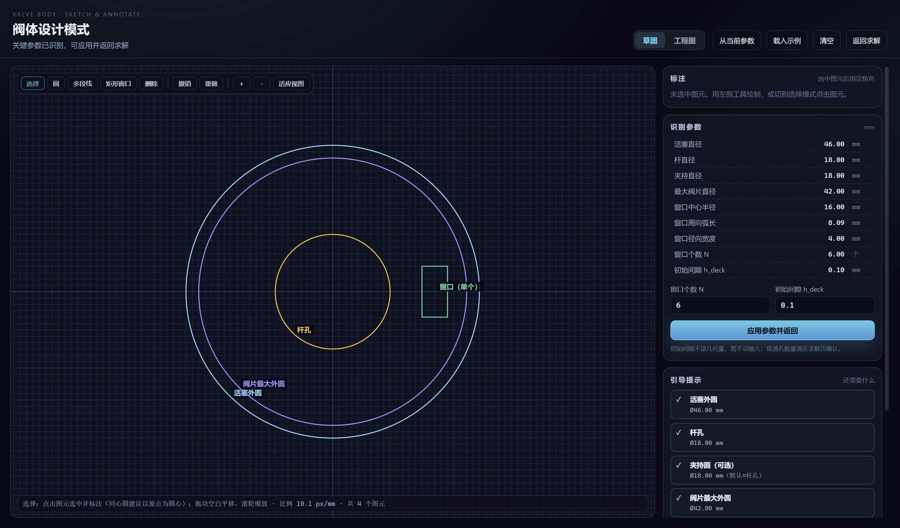
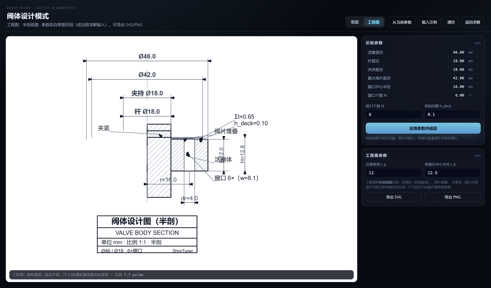
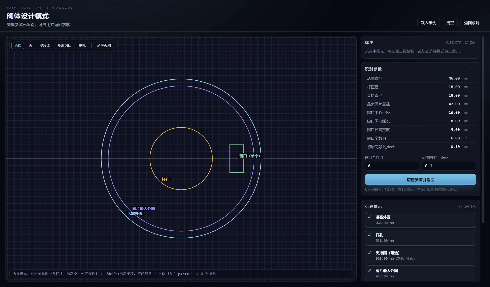

# FlowSolver · 挠度场 + 流道 → 压力场

> **状态：未完成 / 不可用原型。** 请勿用于工程决策或生产环境；详见仓库根目录 [`STATUS.md`](../STATUS.md)。

ShimTuner 项目的第二半：给定**阀片挠度场** `w(r)` 与**总流量 Q**（或活塞速度 v），
求阀片/活塞面之间流道的**稳态压力场** `p(r)`、截流压降与阻尼力 `F`。
服务于最终的 `Q → w → P → w′` 定点迭代器（见 [`../ShimTuner/ShimTunerPhysics.md`](../ShimTuner/ShimTunerPhysics.md)
「模拟逻辑设计」）。

## 物理模型（v1）

```
Q ──▶ 活塞窗口(射流) ──▶ 截流面积 A_th ──▶ 径向间隙流道 h(r) ──▶ 外缘背压 p_back
```

1. **截流面积**（阀片底面与活塞面之间的"帘幕"面积）
   ```
   r_curt = r_port + dr_port/2            （窗口外缘，节流帘幕所在半径）
   w_curt = w_port · r_curt / r_port      （中心弧长 → 外缘弧长）
   A_th = N · w_curt · h(r_curt),          h(r) = h_deck + w(r)
   Δp_curtain = ρ Q² / (2 C_d² A_th²)
   ```
   节流面积取**窗口外缘弧长 × 该处阀片-活塞间隙**：油从窗口外缘越过阀片帘幕，
   再经径向间隙流向阀片外缘。输入 `w_port` 是**中心半径 r_port 处的弧长**，
   求解时按等张角换算到外缘；径向宽度 `dr_port` 决定帘幕半径与外缘弧长。
2. **射流效应**（油束冲击阀片）
   ```
   v_port = Q / A_th,   p_jet = ½ ρ v_port²,   F_jet = C_f ρ Q² / A_th
   ```
   射流在阀片上的作用足迹为椭圆高斯：周向 σ=`w_curt/2`、径向 σ=`dr_port/2`，
   中心位于窗口外缘 `r_curt`，供挠度求解器作为**局部压力包**施加。
3. **径向间隙流**（黏性 + 惯性，次要项）
   ```
   u(r) = Q / (2π r h)
   dp/dr = −12 μ u / h² + ρ u² (1/r + h′/h),     p(r_outer) = p_back
   p_up = p(r_port) + Δp_curtain
   ```
4. **定常旁通孔**（常通孔，可选、固定几何）
   ```
   A_b = n · π/4 · d_b²                    （与阀片挠度无关，不参与迭代）
   Q_b = C_d,b · A_b · sqrt(2 Δp / ρ)      （薄壁孔）
   Q_total = Q_main + Q_b                  并联分流，Δp 由两者共同决定
   ```
   求解时对 `Q_main` 做一维求根，使 `Q_main + Q_b(Δp(Q_main)) = Q_total`；
   `Q_b` 不进入阀片载荷（旁通油不经过阀片底面），但通过改变 Δp 影响 `F_damper`。
5. **油液黏度（工作温度 T）**
   ```
   ASTM D341 (Walther):  log10(log10(ν+0.7)) = A − B·log10(T[K])
   A、B 由 (40°C, KV40) 与 (100°C, KV100) 两点确定 → ν(T)

   ASTM D2270 (VI):  VI = (L − KV40)/(L − H)·100
   L = 0.8353·KV100² + 14.67·KV100 − 216
   H = 0.1684·KV100² + 11.85·KV100 − 97
   ```
   `KV40/KV100 > 0` 时求解使用 `ν(T)`，否则用 `黏度 ν（手动）`；
   VI 用于校验（输入 VI 与 KV40/KV100 反算值偏差 >5 时告警）。
6. 输出
   - 阻尼力 `F_damper = (p_up − p_back) · A_eff`，`A_eff = π/4 (d_p² − d_rod²)`；
   - 阀片受载 `F_shim = ∫(p−p_back)dA + F_jet`；
   - 损失分解（截流/黏性/惯性）、`Re`、截流流速、`Q_main/Q_bypass` 分流；
   - 告警（空化、湍流、间隙过小、常通孔分流占比过高）。

**v1 假设**：轴对称、不可压、定常、层流；无空化/湍流/choked-flow 模型；
挠度场是输入（尚未闭环）。这些都在报告的 `notes` 里明示。

## 文件

| 文件 | 内容 |
|---|---|
| `channel_flow.py` | 物理内核：`PistonSpec` / `FluidSpec` / `PowerLawGap` / `ArrayGap` / `solve_point` / `solve_split`（常通孔并联）/ `solve_curve`，自带数值自检 |
| `flow_checker.py` | Tk GUI（深色主题、双图、KPI/告警面板；含常通孔 Ø/个数/C_d） |
| `couple_demo.py` | Q→w→P→w′ 定点迭代命令行演示 |
| `backend/` | FastAPI 服务：`/api/health`、`/api/config`、`/api/analyze`、`/api/iterate` |
| `desktop/` | Electron 桌面版（Flow Studio：单点求解 + 耦合迭代两种模式） |
| `run-desktop.bat` | 一键启动桌面版（自动建 venv / 装依赖 / 拉起后端） |
| `tests/` | 后端数值回归 |

## 快速开始

```powershell
cd "D:\Desktop\shim stacker\FlowSolver"

# 1) 物理自检（无需 GUI；约 1 s）
python -X utf8 channel_flow.py

# 2) Tk GUI
python -X utf8 flow_checker.py

# 3) 数值后端（可选，任何前端都可调用）
python -m backend --port 8761
# http://127.0.0.1:8761/docs

# 4) Electron 桌面版（Flow Studio）
run-desktop.bat
```

依赖：`numpy`（必需）、`matplotlib`（GUI）、`fastapi`/`uvicorn`（后端）。
本仓库 `..\.venv` 已含全部依赖。

## 演示数据（默认活塞）

| 参数 | 值 |
|---|---|
| 活塞 / 杆径 | Ø46 / Ø18 mm |
| 窗口 | 6 个：周向宽度 8 mm（弧长）× 径向宽度 4 mm，中心半径 16 mm（单窗张角 28.6°） |
| 夹持直径 / 最大阀片直径 | 18 / 42 mm（内部按半径 9 / 21 mm 计算） |
| 初始间隙 h_deck | 0.10 mm |
| 油液 | ρ=850 kg/m³，ν=15 cSt（或 T + KV40/KV100/VI 自动外推） |
| 挠度场 | 幂律：外缘抬升 0.15 mm，h = 0.1 + 0.15·x² |

默认工况（v = 0.25 m/s，即 Q ≈ 0.35 L/s）：
`F ≈ 1619 N`，`Δp ≈ 1.15 MPa`，截流占 94%，射流滞止压 ≈ 0.53 MPa。
低工况（v = 0.05 m/s）黏性项才与截流项同量级——这正是"截流面积主导"的判据。

## 定常旁通孔（常通孔）对阻尼力的影响

常通孔是活塞/阀片上加工的**固定截面油孔**（如 2×Ø1.0 mm），与"窗口 + 阀片间隙"
主阀路径**并联**。它的几何不受阀片挠度影响，因此闭环迭代过程中始终是同一个 `A_b`；
迭代只改变 `Q_main` 与 `Q_b` 的分配比例（`Q_main + Q_b = Q_total`，
`Q_b = C_d,b·A_b·√(2Δp/ρ)`）。

静态挠度场（外缘抬升 0.15 mm，v=0.25 m/s，A_th≈9.96 mm²）下：

| 常通孔 | A_b (mm²) | F (N) | Δp (MPa) | Q_b 占比 |
|---|---|---|---|---|
| 无 | 0 | 1618.8 | 1.150 | 0 % |
| 1×Ø1.0 | 0.785 | 1420.2 | 1.009 | 18.8 % |
| 2×Ø1.5 | 3.534 | 951.3 | 0.676 | 38.2 % |
| 2×Ø2.0 | 6.283 | 681.2 | 0.484 | 51.0 % |

低速段常通孔的相对影响更大（v=0.02 m/s：无孔 57.5 N → 2×Ø1.0 时 38.3 N，−33%）；
高速段主阀开度大、常通孔占比下降。在**闭环迭代**中（3 片堆叠，12×8 网格，2×Ø1.0）：

| v (m/s) | 无孔 F (N) | 有孔 F (N) | Q_bypass (mL/s) |
|---|---|---|---|
| 0.05 | 76.6 | 69.1 | 10.5 |
| 0.15 | 163.9 | 154.9 | 15.7 |
| 0.25 | 238.1 | 228.5 | 19.0 |

配置入口：`piston.bypass_d_mm / bypass_n / bypass_Cd`（请求体）、
Tk GUI 与桌面端「活塞数据」中的**常通孔 Ø / 个数 / C_d**、
命令行 `--bypass-d 1.0 --bypass-n 2 --bypass-cd 0.62`。
报告与 KPI 会给出 `Q_total / Q_main / Q_bypass` 与分流占比，分流 >50%/>90% 时告警。

## 计算性能

分层有限元是主要耗时项；已做以下加速（`DeflectionSolver/shim_layered.py`）：

1. **弹性刚度缓存**：`nl=False` 时弹性 K 与载荷/接触状态无关，只装配一次；
2. **接触罚项增量叠加**：每个接触活动集只需把罚项加到缓存的 K 上，不再重装全部单元；
3. **LU 分解缓存**：按接触活动集（packbits 键）缓存 `splu`，同一活动集跨载荷直接回代；
4. **活动集热启动**：用上一次求解的接触状态作为初值，外层迭代通常 1–2 次即收敛；
5. **流动求解向量化**：压力积分由 Python 循环改为 `cumsum`；
6. **vK 热启动**：非线性求解支持 `U0`，耦合迭代后续步用上一轮位移场起步；
7. **Newton 单次装配**：`_newton` 每次迭代只装配一次（同时得到 r 与 K），不再重复装配；
8. **vK 装配缓存**：弯曲/剪切单元刚度、索引与 Gauss 数据预计算，只重算膜力非线性项；
9. **接触活动集热启动（非线性）**：vK 求解沿用上次接触状态，减少外层循环；
10. **`nl_tol`**：vK Newton 内层容差可放宽到 1e-4（默认 1e-6），再提速约 25%；
11. **扇区降维（周期对称）**：载荷是 N 重周期（N 个均布窗口；轴对称载荷同样成立）时，
    只解 1/N 扇区 + 旋转周期约束 `u_s = R(2π/N)·u_m`，DOF 降为 1/N，结果与整环一致。

实测（3 片堆叠，v=0.25 m/s）：

| 场景 | 优化前 | 优化后 |
|---|---|---|
| 线性分层 solve，12×48（n_dof 7200） | ≈6458 ms/次 | **≈2.5 ms/次** |
| 线性耦合单点 12×12 | ≈3.8 s | **≈0.11 s** |
| 窗口扇区耦合单点 12×48 | ≈66 s | **≈0.8 s** |
| Q–F 曲线 6 点（桌面冒烟） | ≈30 s | **≈1 s** |
| vK 单次 solve 12×12（n_steps=1） | ≈1293 ms | **≈350 ms** |
| vK 耦合单点 12×12 | ≈16.7 s | **≈3.3 s**（nl_tol=1e-4）/ ≈4.2 s（1e-6） |
| vK 耦合单点 16×12 | ≈25.9 s | **≈4.8 s**（nl_tol=1e-4） |
| 线性 + 窗口分布 12×48（扇区 6×8） | — | **≈0.05 s/点** |
| **vK + 窗口分布 12×48（扇区 6×8）** | **≈183.6 s/点** | **≈3.0 s/点（≈60×）** |

外侧帘幕 + 层序修正后实测：线性 12×12 **212.3 N**、线性+窗口 12×48 **234.8 N**、
vK 12×12 **271.4 N**、vK+窗口 12×48 **289.8 N**。扇区降维后
**vK + 窗口分布 12×48 从 183.6 s/点降到约 3 s/点（约 60×）**，
F 与迭代次数与整环一致（289.8 N / 10 次）。
vK 的剩余时间主要在 Newton 迭代与稀疏分解；下一步可做 Aitken/Anderson 外层加速、
向量化稀疏组装，或分阶段 vK（线性收敛后 1–2 次 vK 修正）。

## Tk GUI（零依赖，最快上手）

* 左侧：活塞几何 / 油液 / 系数（C_d、C_f）/ 挠度场（幂律或导入 CSV、JSON）/ 工况；
* 右侧：`h(r)` 与 `p(r)`（双 y 轴）、`F(v)` 曲线，标注落座/窗口/外缘半径；
* 报告：F、Δp、A_th、截流流速、射流滞止压、Re、损失分解、告警；
* 参数改动 300 ms 防抖自动重算。

## 桌面端（Electron · Flow Studio）

**推荐**：双击项目根目录的 `ShimTuner.exe` → 选择「Flow Studio」（见根 README「一键启动」）。
启动器会复用本目录的 `node_modules` 与 `.venv`，无需批处理。

备用：

```powershell
cd "D:\Desktop\shim stacker\FlowSolver"
run-desktop.bat            # 或: cd desktop && npm start
```

* 后端由 Electron 主进程自动拉起（`python -m backend`，随机空闲端口，健康检查/重启）；
* 渲染层手写 Canvas 图表（与 DeflectionSolver 桌面版同一 `chart.js`），零前端依赖；
* **四种模式**：
  * 单点求解：活塞/油液/系数/幂律挠度场/工况 → `p(r)`、`F(v)`、KPI、损失分解；
  * 耦合迭代：阀片堆叠 + 迭代参数（α、容差、最大迭代、网格、vK 开关）→
    残差收敛曲线 + 收敛后的 `p(r)`、`w(r)`、F/KPI；
  * **Q–F 曲线**：给定 v 区间与点数，逐点闭环迭代（相邻点热启动）→
    F(Q) 曲线 + 逐点迭代次数/残差 + 汇总 KPI；
  * **v–F 杆速**：流量由杆侵入油缸的体积速度决定 →
    `F(v)` 曲线（可加回弹分支）；`Q_valve/Q_rod` 为线性换算，只列在报告表格中；
* 导入/导出工况 JSON（`shimtuner-flow-case/1`），复制报告；
* **避震项目管理**（侧栏「避震项目」）：
  * 新建 / 打开 / 保存 / 另存为项目；项目目录默认 `文档\ShimTunerProjects`；
  * 项目文件包含项目名称、车型/编号、安装位置、阀类型、备注，以及**多套方案**：
    **阀片组方案**（layers 列表）与**限流孔方案**（窗口/常通孔参数）；
  * 同一项目中可随时切换阀片组/限流孔方案，立即套用输入并重算，随项目一起保存；
  * 读取项目时自动填回全部工况与方案，并读取 `project.reserved` 等**预留字段**；
    未识别字段原样保留，保存时不会丢失（可用于对接测功机/PLM）；
  * 示例文件：`FlowSolver/projects/示例-前减震.json`；
* 冒烟测试：
* **阀体设计（草图 / 工程图）**：顶栏「阀体设计」打开；
  * **草图**：圆 / 矩形 / 多段线绘制 + 角色标注（活塞外圆、杆孔、夹持圆、
    最大阀片外圆、窗口、常通孔），自动识别活塞/窗口/夹持/阀片参数；
    支持「从当前参数」生成草图、撤销/重做、缩放/平移，快捷键
    `Ctrl+Z` / `Ctrl+Y` / `F` / `+` / `-` / `Enter` / `Esc`；
  * **工程图**：半剖 CAD 视图，按识别参数（或当前求解输入）自动绘制
    活塞体（剖面线）、阀片堆叠、夹紧环、窗口与常通孔，带直径/轴向尺寸
    与标题栏；可导出 **SVG / PNG**；
  * 工程图专用参数：**活塞厚度 t_p**、**常通孔中心半径 r_b**（仅绘图，不写回求解）；




* 冒烟测试：

```powershell
cd desktop
npm run smoke           # 单点模式端到端（Electron + 渲染 + 后端）
npm run smoke:iterate   # 耦合迭代模式端到端
npm run smoke:curve     # Q–F 曲线模式端到端
npm run smoke:rod       # v–F 杆速模式端到端
npm run smoke:design    # 阀体设计：草图识别 / 工程图 tab / 撤销 / 导出链路
npm run smoke:project   # 项目管理：payload / 方案切换 / 预留字段读取
npm run test:design     # design.js + valve-drawing.js 纯几何单测（Node）
```

## 耦合迭代接口 `/api/iterate`

请求：`layers[]` + `piston` + `fluid` + `coefficients` + `iterate{ v_mps, alpha,
tol_um, max_iter, relax_step_um, nl, n_radial, n_theta, window_load, window_contrast, sector_reduction, nl_tol }`。
后端调用 `DeflectionSolver` 的 `LayeredStack`（同级目录），用
`set_pressure(p(r,θ))` 施加流道压力与射流压力包，按 `w ← w + α·clip(w_P − w)`
迭代，返回：

```json
{
  "charts": {"convergence": {...}, "pressure": {...}, "deflection": {...}},
  "report": {"kpis": [...], "warnings": [...], "lines": [...]},
  "meta": {"converged": true, "iterations": 13, "residual_um": 1.17,
           "history": [...], "F_damper": 146.3}
}
```

默认演示（3 片 18/42、18/36、18/30，v=0.15 m/s；**第 1 片贴活塞，油压作用其底面**）约 10 次迭代收敛，残差 ~1 µm，单点约 0.2 s。

### 窗口分布载荷（v2，可选）

`iterate.window_load=true` 时，阀片载荷由"环向均布"改为**连续分布函数**（不是阶跃掩膜）：

**① 周向平滑调制**（均值 1，处处为正，无阶跃）：

$$W(\theta)=1+c\cos(N\theta),\qquad c=\texttt{window\_contrast}\ (\text{默认 }1-\text{覆盖率})$$

$$p_{base}(r,\theta)=p_{back}+\bigl(p_{raw}(r)-p_{back}\bigr)\,\bigl[1+(W(\theta)-1)\,D(r)\bigr]$$

其中 `p_raw` 在落座区为 `p_up`、流道区为 `p(r)`；`D(r)` 为下游衰减（落座区 1，流道区
`exp[-(r−r_port)/(r_out−r_port)]`），表示油在间隙内逐渐沿周向铺开。

**② 射流冲击斑**（椭圆高斯，叠加，不删除任何区域）：

$$p_{jet}(r,\theta)=\sum_{k=1}^{N}p_{jet}\exp\!\left[-\frac12\left(
\left(\frac{r-r_{port}}{\sigma_r}\right)^2+
\left(\frac{r\,\Delta\theta_k}{\sigma_c}\right)^2\right)\right]$$

$$\sigma_c=\frac{w_{port}}{2}\ (\text{周向}),\qquad
\sigma_r=\frac{d_{r,port}}{2}\ (\text{径向})$$

周向宽度与径向宽度相等时（`w_port=dr_port`）就是**圆形**过孔；长条窗口得到的是椭圆斑。
这样窗口数据同时包含周向、径向两个尺寸，而不是只用一个宽度描述所有形状。

总载荷 `p_load = p_base + p_jet`。关键在于：**窗口中心与窗间的射流斑都保留**（窗间只是
叠加值较小，不是 0），落座区压力也处处为正（只是周向起伏）。

* 开启后 `n_theta` 自动抬到 ≥48（分辨射流斑），并自动做**扇区降维**（1/N 扇区 + 周期边界），
  等效分辨率不变、DOF 降为 1/N；`iterate.sector_reduction=false` 可关闭（用于对照验证）；
* 旧参数 `sector_load` 作为兼容别名（等价于 `window_load`）；旧的"阶跃掩膜"已删除；
* `window_contrast` 缺省 = `1−覆盖率`（默认几何 47.7% 覆盖 → c≈0.52）。

## 与迭代器的衔接（已实现）

`ShimTunerPhysics.md`「模拟逻辑设计」的闭环已跑通：

1. 给定 `w_k(r)` 与 Q → 本求解器给出 `p_k(r)`（含窗口处射流压力包）；
2. `p_k(r)` 作为阀片底面载荷交给 DeflectionSolver 的分层模型 → `w_P(r)`；
3. 残差 `max|w_P − w_k|`，不满足则 `w_{k+1} = w_k + α·clip(w_P − w_k)`；
4. 收敛后输出 `F`（`meta.F_damper`）。

接口：后端 `POST /api/iterate` / 桌面端「耦合迭代」模式 / 命令行 `couple_demo.py`。

## Q–F 曲线接口 `/api/fv-curve`

请求：`layers[]` + `piston` + `fluid` + `coefficients` +
`curve{ v_min_mps, v_max_mps, n_points, alpha, tol_um, max_iter, relax_step_um, nl, n_radial, n_theta }`。

逐速度点执行一次 `/api/iterate` 的闭环（相邻点用上一点 `w` 热启动），返回：

```json
{
  "charts": {"curve": {...}, "convergence": {...}},
  "report": {"kpis": [...], "warnings": [...], "lines": [...]},
  "meta": {"points": [{"Q_m3s":..., "v_mps":..., "F_N":..., "iterations":...,
                        "residual_um":..., "converged": true}],
           "n_converged": 6, "n_points": 6, "total_ms": 26900}
}
```

默认演示（3 片，v 0.02→0.5 m/s，6 点，16×12 网格）：**F ≈ 40 → 350 N，6/6 收敛**，
平均 8.7 次迭代，约 1 s（优化后；热启动显著减少后续点迭代次数）。

## 杆速–阻尼力接口 `/api/rod-curve`

流量由**活塞杆侵入油缸的体积速度**决定，而不是独立给定：

```
A_p = π/4·D²          活塞面积
A_rod = π/4·d_rod²    杆面积
Q_rod  = A_rod·v      杆排开的体积速度（单筒进蓄能腔 / 双筒经底阀回油）
Q_valve = (A_p − A_rod)·v   通过活塞阀的流量 ← 本求解器输入
```

请求：`layers[]`（压缩堆叠）+ `layers_rebound[]`（可选，回弹堆叠）+
`piston` + `fluid` + `coefficients` + `curve{...}`。
返回 `charts.force`（F(v)，压缩实线/回弹虚线）；`meta.branches` 含每个分支的逐点数据。
`Q_valve / Q_rod` 随 v 是纯线性换算，只出现在报告表格与 `meta` 中，不再单独成图。

**阀类型切换**（`valve_type`）：
* `mid`（默认，活塞阀）：`Q_valve=(A_p−A_rod)·v`，阻尼力面积 `A_eff`；
* `base`（底阀/foot valve）：`Q_base=A_rod·v`（杆侵入油缸的体积速度），阻尼力面积 `A_rod`；底阀计算时应把活塞几何/窗口/阀片堆叠换成底阀自身的参数。
* 入口：桌面端「v–F 杆速」面板单选、API `valve_type`、CLI `--valve base`。

默认演示（Ø46/Ø18 → A_p=1661.9、A_rod=254.5、A_eff=1407.4 mm²）：

| 行程 | v=0.05 | v=0.15 | v=0.25 m/s |
|---|---|---|---|
| 压缩（3 片，mid） | 68.8 N | 146.3 N | 212.1 N |
| 回弹（2 片薄堆叠，mid） | 57.9 N | 122.1 N | 176.4 N |
| 压缩（base，同几何） | 4.5 N | 8.6 N | 11.7 N |
| 回弹（base，同几何） | 3.9 N | 7.2 N | 9.8 N |

> base 与 mid 使用同一组几何时，base 流量小得多（`A_rod/A_eff≈18%`），力也显著更低；实际底阀几何（窗口/阀片）更小，应单独输入。

对应 Q_valve = 70.4 / 211.1 / 351.9 mL/s，Q_rod = 12.7 / 38.2 / 63.6 mL/s；
每点内部仍是 Q→w→P→w′ 闭环迭代（压缩 6 点约 1 s）。

## 阀体设计模式（草图 → 标注 → 参数识别）

桌面端右上角「阀体设计」进入全屏草图模式（`desktop/renderer/design.js`），
用于从阀体几何草图直接识别求解所需的活塞/窗口参数：



操作流程：

1. 画布原点 = 活塞中心，单位为 mm，网格 1 mm；滚轮缩放、Shift+拖动平移；
2. 用「圆 / 多段线 / 矩形窗口」画出闭合轮廓（圆：圆心拖动半径；多段线：依次点顶点，
   双击/回车闭合）；
3. 切到「选择」点击图元，在右侧「标注」里指定角色：
   活塞外圆 / 杆孔 / 阀片最大外圆 / 窗口（单个）/ 夹持圆（可选）/ 常通孔（可选）；
4. 右侧「引导提示」实时列出还缺什么、下一步该画什么；「识别参数」表实时给出
   直径、窗口中心半径、周向弧长、径向宽度、个数 N、初始间隙；
5. 「应用参数并返回」写回活塞/窗口输入框并自动重算（初始间隙不是几何量，需手输）。

识别口径：

| 标注 | 识别结果 |
|---|---|
| 活塞外圆 / 杆孔 / 阀片最大外圆 / 夹持圆（不画则默认等于杆孔） | `D = 2R`（直径） |
| 窗口（圆） | `r_port=圆心半径`；周向弧长按 `2·r_port·asin(r/r_port)`；径向宽度 `2r` |
| 窗口（闭合多段线） | `r_port=面积质心半径`；周向弧长按该半径圆周与轮廓的交点求角向跨度；径向宽度按质心角向射线求交 |
| 窗口个数 N | 右侧输入框（其余按 N 等角均布） |
| 常通孔圆 | `bypass_d_mm=2r`，个数回求解页确认 |
| 初始间隙 h_deck | 手动输入（几何无法识别） |

自检：

```powershell
cd FlowSolver\desktop
npm run test:design     # Node 端识别逻辑测试（无需 Electron）
npm run smoke:design    # Electron 端到端：打开设计模式→载入示例→应用→写回输入框
```

当前为「草图→识别」MVP；读取外部 DXF/SVG/图纸图像并自动提取闭合轮廓可作为下一步扩展。

## 常见问题

* **双击 `run-desktop.bat` 一闪而过 / 没反应**：多半是脚本带 UTF-8 BOM，cmd 会把首行
  读成 `锘緻echo off` 而立即报错。本仓库已修正为无 BOM；若再出现，用编辑器另存为
  「UTF-8 无 BOM」，或直接在 `desktop` 目录执行 `npm start`。
* **窗口空白 / 立刻退出**：确认 `ELECTRON_RUN_AS_NODE` 不是 `1`（批处理会自动清除；
  手动跑 `npm start` 前先执行 `set ELECTRON_RUN_AS_NODE=`）。
* **提示找不到 Python**：在仓库根 `.venv` 中执行
  `python -m pip install -r FlowSolver\requirements-ui.txt`，或设置 `SHIMTUNER_PYTHON`。
* **迭代模式慢**：默认 16×12 网格、约 8–9 s；可减小 `n_radial/n_theta` 或放宽容差。
