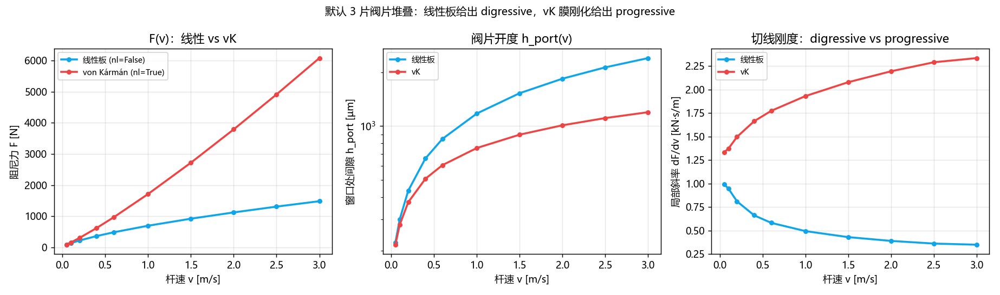
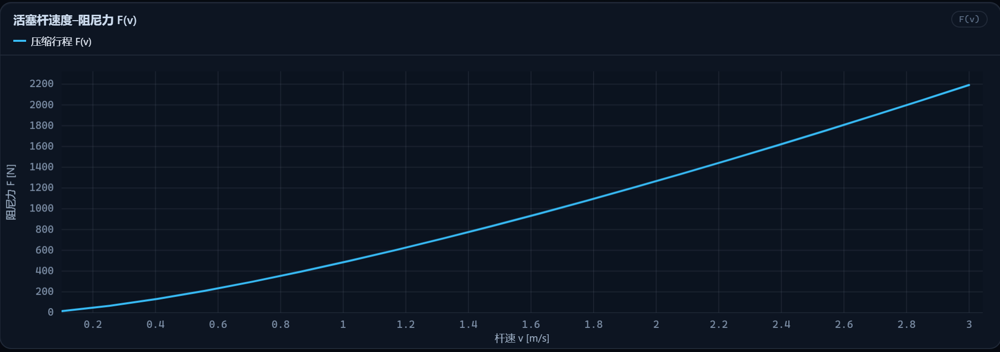

# ShimTuner 物理模型 / 求解逻辑与 F–v 曲线偏差分析

> 日期：2026-11-17（2026-11-24 修订：阀片层序修正）  
> 范围：DeflectionSolver + FlowSolver + ShimTuner 总入口  
> 结论摘要：当前模型（尤其打开 von Kármán 膜力后）给出的杆速–阻尼力曲线呈 **progressive / aggressive（上翘）**，
> 而测功机（dyno）实测减振器通常呈 **digressive（下折）**。这不是求解器数值错误，而是
> **阀片结构模型 + 缺失高速限压机制** 共同造成的模型边界问题。本文给出模型、求解逻辑、证据与改进路线。

---

## 0. 现象与结论

* 默认 3 片堆叠（Ø18/42×0.25、Ø18/36×0.20、Ø18/30×0.20；**第 1 片贴活塞、油压作用其底面**），v = 0.05→3 m/s：
  * **线性板（nl=False）**：F 68.8 → 1224.3 N，拟合指数 ≈ **0.70**（digressive，与 dyno 趋势一致）；
  * **von Kármán（nl=True）**：F 71.1 → 4231.5 N，拟合指数 ≈ **1.00 → 切线刚度随 v 递增**（progressive，与 dyno 相反）。
* 2026-11-24 修正层序；2026-11-25 修正帘幕位置：节流面积改为**窗口外缘弧长 × 外缘处间隙**（此前误用窗口中心 r_port）。修正后 F 绝对值变化（趋势结论不变）。
* 同一套阀片、同一套流道参数，**唯一差别是阀片结构模型是否含膜拉伸刚化**，曲线趋势就发生了反转。
* 因此首要原因是：**vK 膜刚化在“大挠度”区间把阀片变得过刚，开度增长跟不上流量增长**；
  同时模型缺少真实减振器实现 digressive 的几类关键机制（限位/背托、blow-off 二级阀片、座面预紧开启、
  空化/阻塞流限压、油液可压缩性）。



用户桌面端当前给出的 F(v) 曲线（另一组界面参数，v_max=3 m/s；形状同样上翘）：



对比：真实 dyno 曲线通常为 digressive——低速段斜率大、进入高速段后明显放缓并趋于平台，
而当前模型（尤其 vK）在高速段斜率反而越来越大。

---

## 1. 项目结构与数据流

```
                 ┌──────────────────────────────┐
   杆速 v  ───▶  │ 运动学: Q_valve=(A_p−A_rod)·v │
                 │          Q_rod = A_rod·v      │
                 └──────────────┬───────────────┘
                                │ Q（总流量）
                                ▼
   ┌────────────────────────────────────────────────┐
   │ FlowSolver: 给定挠度场 w(r) → 压力场 p(r)      │
   │  · 窗口截流 A_th = N·w_out·h(r_out)            │
   │  · 射流 p_jet / F_jet                          │
   │  · 径向间隙流（黏性+惯性）                     │
   │  · 常通孔（固定几何并联分流）                  │
   │  → Δp、F = Δp·A_eff、F_shim、告警              │
   └───────────────┬────────────────────────────────┘
                   │ p(r) 作为阀片底面载荷
                   ▼
   ┌────────────────────────────────────────────────┐
   │ DeflectionSolver: 分层 Mindlin 板 + 单边接触    │
   │  · 每层独立中面 5 DOF，层间罚接触（μ=0）        │
   │  · 可选 von Kármán 膜力（几何非线性）           │
   │  → 新挠度场 w_P(r)                              │
   └───────────────┬────────────────────────────────┘
                   │ w_{k+1} = w_k + α·clip(w_P − w_k)
                   ▼
            收敛判据 max|Δw| < tol ⇒ 输出 F
```

三个子项目：

| 目录 | 职责 | 关键文件 |
|---|---|---|
| `DeflectionSolver/` | 压力场 → 阀片挠度场 | `shim_physics_core.py`（1D 环）、`shim_fem_plate.py`（2D Mindlin）、`shim_nl_plate.py`（2D vK）、`shim_layered.py`（分层+接触） |
| `FlowSolver/` | 挠度场 + 流量 → 压力场 | `channel_flow.py`、`coupling.py`（定点迭代）、`backend/`（FastAPI）、`desktop/`（Electron） |
| `ShimTuner/` | 总入口与文档 | `fv_curve.py`（v–F 闭环）、`ShimTunerPhysics.md` |

---

## 2. 物理模型

### 2.1 运动学（杆速 → 流量）

$$A_p=\frac{\pi}{4}D^2,\quad A_{rod}=\frac{\pi}{4}d_{rod}^2,\quad A_{eff}=A_p-A_{rod}$$

$$Q_{valve}=A_{eff}\,v,\qquad Q_{rod}=A_{rod}\,v$$

* `Q_valve`：通过活塞阀的总流量（进入主阀 + 常通孔）；
* `Q_rod`：活塞杆侵入油缸排开的体积速度（单筒进蓄能腔 / 双筒经底阀）。

### 2.2 阀片/流道几何

| 参数 | 默认 | 含义 |
|---|---|---|
| 窗口数 `N` | 6 | 活塞端面均布油道数 |
| 窗口周向宽度 `w_port` | 8 mm | 中心半径处的单窗弧长（求解换算到外缘） |
| 窗口径向宽度 `dr_port` | 4 mm | 单窗径向尺寸；决定帘幕外缘 r_out = r_port + dr/2 |
| 窗口中心半径 `r_port` | 16 mm | 油流出口/射流位置 |
| 夹持直径 `D_clamp` | 18 mm | 阀片夹持圆（半径 9 mm，内边界固支） |
| 最大阀片直径 `D_outer` | 42 mm | 阀片自由外缘（半径 21 mm） |
| 初始间隙 `h_deck` | 0.10 mm | 阀片底面与活塞面冷态间隙 |
| 常通孔 `n×d_b, C_db` | 0（默认关） | 固定几何旁通 |

> **窗口形状说明**：`N、w_port、r_port` 只定义了"中心半径 `r_port` 处、周向弧长
> `w_port` 的 N 条弧槽"，无法单独区分圆形孔与长条窗；圆形孔需 `w_port = dr_port = d`。
> 真实圆孔的周向宽度随半径变化，本模型把窗口塌缩到 `r_port`（弧槽等效），
> 新增 `dr_port` 用于射流斑的径向尺寸。

### 2.3 流道–压力场（FlowSolver v1）

1. **窗口截流**（主导项）

$$r_{out}=r_{port}+\frac{dr_{port}}{2},\qquad w_{out}=w_{port}\frac{r_{out}}{r_{port}}$$
$$A_{th}=N\,w_{out}\,h(r_{out}),\qquad h(r)=h_{deck}+w(r)$$

$$\Delta p_{curtain}=\frac{\rho Q_{main}^2}{2C_d^2A_{th}^2},\qquad v_{port}=\frac{Q_{main}}{A_{th}}$$

> 节流发生在**窗口外缘**：`A_th` 用外缘弧长（中心弧长按等张角换算）与 `r_out` 处的阀片间隙；流道积分从 `r_out` 到 `r_outer`。

2. **射流效应**

$$p_{jet}=\tfrac12\rho v_{port}^2,\qquad F_{jet}=C_f\frac{\rho Q_{main}^2}{A_{th}},\qquad \sigma_c\approx w_{out}/2$$

3. **径向间隙流**（黏性 + 惯性，次要项）

$$u(r)=\frac{Q_{main}}{2\pi r h},\qquad
\frac{dp}{dr}=-\frac{12\mu u}{h^2}+\rho u^2\left(\frac1r+\frac{h'}{h}\right),\qquad p(r_{outer})=p_{back}$$

4. **常通孔（固定截面并联）**

$$A_b=n\frac{\pi}{4}d_b^2,\qquad Q_b=C_{db}A_b\sqrt{\frac{2\Delta p}{\rho}},\qquad Q_{main}+Q_b=Q_{valve}$$

对 `Q_main` 一维求根（Δp(Q_main) 单调）实现分流；`A_b` 不随挠度/迭代变化。

5. **输出**

$$F_{damper}=\Delta p\cdot A_{eff},\qquad
F_{shim}=\int (p-p_{back})\,dA+F_{jet}$$

并输出截流/黏性/惯性损失占比、Re、`Q_main/Q_bypass` 分流与告警（空化、湍流、间隙过小、射流流速过高）。

### 2.4 阀片结构（DeflectionSolver）

**分层 Mindlin 板 + 单边接触**（主力模型，`shim_layered.py`）：

* 每层独立中面位移场 $(u,v,w,\phi_x,\phi_y)$（5 DOF/节点）；
* 层间单边接触：间隙 $g=w_{bottom}-w_{top}$，$g<0$ 时以罚刚度 $k_n=10^{15}$ Pa/m 激活；
* 摩擦按项目决策取 $\mu\equiv0$；
* 分片可分离（外伸段自由、落座段固支）。

**von Kármán 膜力**（`shim_nl_plate.py` / `shim_layered.py` 的 `nl=True`）：

* 在应变中保留中面面内位移的一阶/二次项，产生膜应变能；
* 夹持边界使面内位移受限 ⇒ 大挠度时中面被拉伸 ⇒ **几何刚化**；
* 小挠度极限退化为线性板（自检 [1] 相对差 1.9e-10），切线一致性 6.6e-10。

### 2.5 耦合迭代（`coupling.py`）

```
w⁰ = 0（或上一点的收敛解，热启动）
for k = 1..max_iter:
    h(r) = h_deck − w_k(r)
    (Q_main, Q_bypass) ← 并联分流（常通孔求解）
    p(r) ← FlowSolver(Q_main, h)                     # 截流+射流+间隙流
    阀片载荷 ← −(p − p_back + p_jet 压力包)
    w_P ← DeflectionSolver(载荷, 堆叠)               # 线性 / vK
    Δ = clip(w_P − w_k, ±Δmax)
    w_{k+1} = w_k + α·Δ
    if max|Δ| < tol: break
输出 F = Δp·A_eff（用收敛后的 w 再算一次流场）
```

默认参数：`α=0.5`、`Δmax=150 µm`、`tol=2 µm`、`max_iter=25`、分层网格 16×12（径向×周向）。

### 2.6 曲线求解逻辑

* **v–F 杆速曲线**：`v = [v_min … v_max]` 逐点做上述闭环；后一点用前一点 `w` 热启动；
* **Q–F 曲线**：同逻辑，横轴换成活塞阀流量 $Q_{valve}$；
* 每点内部仍然是完整的 `Q→w→P→w′` 定点迭代，不是把 Q 当连续变量的近似延拓。

---

## 3. 当前计算结果（默认堆叠）

数据见同目录 `fv_linear_vs_vk.csv`，图见 `fig_fv_linear_vs_vk.png`。

| v (m/s) | 线性 F (N) | vK F (N) | 线性 h_port (µm) | vK h_port (µm) |
|---|---|---|---|---|
| 0.05 | 82.5 | 89.0 | 222 | 216 |
| 0.10 | 132.0 | 155.7 | 300 | 279 |
| 0.20 | 217.8 | 300.2 | 435 | 374 |
| 0.40 | 360.6 | 619.7 | 658 | 507 |
| 0.60 | 482.3 | 965.5 | 849 | 604 |
| 1.00 | 692.2 | 1711.3 | 1176 | 753 |
| 1.50 | 918.6 | 2718.9 | 1529 | 895 |
| 2.00 | 1121.0 | 3790.8 | 1844 | 1011 |
| 2.50 | 1307.1 | 4914.6 | 2134 | 1109 |
| 3.00 | 1481.1 | 6082.5 | 2406 | 1197 |

幂律拟合 $F\propto v^n$（0.05→3 m/s）：

* 线性板：$n\approx0.71$ → **digressive**（切线刚度递减）；
* vK：$n\approx1.03$，且切线刚度 $dF/dv$ 单调递增 → **progressive**。

> 注：截图中 F(3 m/s) ≈ 2.2 kN 来自另一组参数，但同样呈上翘趋势；本报告用默认参数说明机理，
> 趋势不依赖具体数值。

### 3.1 模型适用域检查（vK，v = 3 m/s）

| 指标 | 数值 | 判据 | 结论 |
|---|---|---|---|
| 窗口流速 `v_port` | ≈74 m/s | >50 m/s 告警 | 不可压/层流假设失效，真实会空化/choked |
| 间隙入口 Re | ≈2800 | >2000 告警 | 层流假设失效 |
| 窗口开度 `h_port` | 1.20 mm | 远大于 `h_deck`=0.1 mm | 超出真实阀片行程 |
| 顶片挠度/厚度 `w_tip/t` | ≈6.5 | 薄板理论适用 `w/t<0.5`，vK 约到 1–2 | **远超适用范围** |

即：v = 1–3 m/s 区间，当前模型的**结构假设和流体假设都已越界**，此处 F 的绝对值和趋势都不能直接对标 dyno。

---

## 4. 为什么 dyno 是 digressive，而当前模型是 progressive

### 4.1 关键机理：开度–压力关系决定的指数

设阀片开度 $h$ 随压力按幂律增长 $h\propto p^m$，则

$$A_{th}\propto h\propto p^m,\qquad
\Delta p \propto \frac{Q^2}{A_{th}^2}\propto Q^2p^{-2m}$$

令 $\Delta p=p$，得

$$p\propto Q^{\frac{2}{1+2m}},\qquad F\propto v^{\frac{2}{1+2m}}$$

| 阀片行为 | m | F∝v 指数 | 曲线形状 |
|---|---|---|---|
| 固定开度（纯节流孔） | 0 | 2.0 | aggressive |
| 线性板 $h\propto p$ | 1 | 0.67 | **digressive** |
| vK 膜主导 $h\propto p^{1/3}$ | 1/3 | 1.2 | **progressive** |

实测默认堆叠：线性 0.71（接近理论 0.67），vK 1.03（高于 1，叠加了黏性/惯性/接触细节）。
**结论：vK 膜刚化把指数从 <1 推到 >1，是曲线由 digressive 翻转为 progressive 的直接原因。**

### 4.2 为什么真实减振器是 digressive

真实减振器在高速段有多重"限压/增面积"机制，且是刻意设计的（兼顾低速控制力与高速舒适性）：

1. **Blow-off / 二级阀片**：压力达到开启压力后，第二组阀片（或背托上的阀片）打开，
   流通面积阶跃式增大 → Δp 增速骤降，形成 digressive 的"拐点"。
2. **限位/背托（backstop）**：阀片最大开度被活塞凹槽/背托限制。开度饱和后，
   面积不再增长，压力不会继续按 $1/h^2$ 加速上升。
3. **座面预紧/开启压力（crack pressure）**：低速段阀片贴在座面上（近似关闭），
   开启后刚度骤降 → 低速斜率大、高速趋缓，这是典型的双线性 digressive 特征。
4. **空化 / 阻塞流（choked flow）**：高速时窗口流速达到数十 m/s，压力降到蒸气压附近，
   油液空化、流量被阻塞 → Δp 不再随 Q² 上升，形成压力平台。
5. **油液可压缩性/气室储能**：高压段一部分流量用于压缩油液与气室，压力上升变缓。
6. **多级/多路径**：活塞阀 + 底阀 + 泄流孔/缺口 + 单向阀共同分担流量，高速段大流量走低阻路径。

### 4.3 当前模型缺什么

| 缺失机制 | 当前模型行为 | 后果 |
|---|---|---|
| 最大开度限位 | 开度无上限（h 可到 1.2 mm） | 面积继续增长但被 vK 刚度拖住，压力反而加速上升 |
| blow-off / 二级阀片 | 单一阀片堆叠 | 无面积阶跃，无拐点 |
| 座面接触/预紧开启 | `h_deck>0` 常开缝，无 crack pressure | 低速段偏软、高速段无"关闭→开启"转折 |
| 空化 / 阻塞流 | 无；仅告警 | 高速段 Δp 无上限 |
| 可压缩性 / 气室 | 不可压 | 高压段储能缺失 |
| 阀片大转动/大挠度真实行为 | 单块环形板 + vK | w/t≈6.5 时模型不可信；真实阀片会局部掀开、贴合背托、膜力被接触/塑性/几何改变 |

补充：**vK 本身不是错误**——对"夹持圆板、面内不可滑移"的大挠度问题是正确的物理；问题在于本模型的
阀片可以无限抬升、无背托接触、无座面预紧，于是 vK 在越界区间把阀片"算得越来越硬"。
真实阀片在同样压力下会先被背托或几何限位挡住（开度饱和），或局部掀开脱离座面，而不会继续保持
"整块圆板继续弯曲 + 膜力无限增长"。

### 4.4 低速段对照

当前模型 v=0.05 m/s 时 F≈89 N，主要来自 `h_deck` 间隙的黏性流（v=0.02 m/s 时分解：
黏性 71.8%、截流 30.6%、惯性 2.4%——各占比按不同积分项计算，因惯性项可正可负，占比之和可能超过 100%）。
真实 dyno 低速段通常斜率更高（预紧/座面关闭 + 泄流孔控制），因此当前模型在低速段偏软、
高速段偏硬，整体呈"反 S"形状，与 digressive 的"低速陡、高速平"恰好相反。

---

## 5. 改进路线（优先级）

### P0 — 标定与验证（不改模型也能做）

1. 用 dyno 数据标定：`h_deck`、常通孔 `A_b/C_d`、阀片组厚度、`C_d/C_f`；
2. 定义对比 KPI：低速斜率 `dF/dv|v<0.1`、拐点速度 `v_knee`、高速斜率 `dF/dv|v>1`、`F(0.5/1/2 m/s)`；
3. 对比时统一 `p_back`（气室预充）与油温（黏度）。

### P1 — 结构（最可能把曲线掰回 digressive）

1. **最大开度限位/背托**：`h_eff = min(h_eff, h_max)`，`h_max` 由活塞凹槽/背托几何给出；
2. **blow-off 二级阀片**：给定开启压力 `p_open` 与附加面积 `A_2(p)`，
   达到后并联第二流通面积；
3. **座面接触/开启压力**：阀片初始贴合座面（`h=0`），`p<p_crack` 时无主阀流量，
   仅泄流孔/缺口流通；`p>p_crack` 后按阀片刚度开启；
4. 大挠度区间限制 vK 使用范围（`w/t<1.5`），超出时用背托/接触接管，避免膜力无限增长。

### P2 — 流体

1. 空化/阻塞流限压：`p_min≥p_vapor` 时限制 `Q`（等效 choked flow）；
2. 湍流修正（高 Re 时 `C_d` 与摩擦系数随 Re 变化）；
3. 温度–黏度模型（油温对 F 影响显著）；
4. 油液可压缩性/气室模型（单筒）。

### P3 — 求解与工程化

1. vK 开启时的网格与收敛检查（切线一致性、w/t 提示）；
2. 曲线扫掠的连续性/热启动稳定性；
3. 与 dyno 数据自动对比报表（CSV 输入 → KPI/图）。

---

## 6. 结论

1. 当前 vK 模型给出的 F(v) 上翘是**模型边界内的必然结果**：膜刚化使开度增长慢于压力增长，
   指数从 digressive 的 <1 推到 >1；线性板对照（指数 0.71）证实趋势反转由 vK 引起。
2. 真实 dyno 的 digressive 依赖模型尚未实现的机制：**限位/背托、blow-off、座面预紧、空化/阻塞、可压缩性**。
3. 因此当前 F(v) 曲线不能直接用于对标 dyno；需要先做 P0 标定，再做 P1 结构扩展（尤其限位与二级阀片）。
4. 在 v = 1–3 m/s 区间，模型已超出薄板与不可压层流假设（w/t≈6.5、v_port≈74 m/s、Re≈2800），
   该区间的绝对值不应作为设计依据。

---

## 附录 A：复现

```powershell
# 生成本报告数据与图
python -X utf8 汇报\_gen_report_data.py    # 或使用 FlowSolver 的 coupling API
# 命令行 v–F 曲线（vK 开关）
cd ShimTuner
python -X utf8 fv_curve.py --points 10 --v-min 0.05 --v-max 3.0 --nl
# 桌面端
FlowSolver\run-desktop.bat   # v–F 杆速 → 勾选 vK → 运行
```

## 附录 B：文件清单

| 文件 | 内容 |
|---|---|
| `汇报/物理模型与F-v曲线分析.md` | 本报告 |
| `汇报/fig_fv_linear_vs_vk.png` | F(v)、开度、切线刚度三联图（线性 vs vK） |
| `汇报/observed_Fv_screenshot.png` | 桌面端当前 F(v) 曲线（用户截图） |
| `汇报/fv_linear_vs_vk.csv` | 线性/vK 逐点数据（v, F, Δp, h_port, w_tip, 迭代次数） |
| `汇报/_gen_report_data.py` | 重新生成上述 CSV/图的脚本 |
| `汇报/_pressure_approx_study.py` | 附录 C 的压力场近似精度试验脚本 |

---

## 附录 C：压力场近似的精度估计

**结论先行：迭代中使用的不是“压差等效均布压力场”**，而是流道解给出的**径向分布**
（落座区 $p_{up}$、流道区 $p(r)$、窗口处高斯射流包）。总力才用 $\Delta p\cdot A_{eff}$ 的等效口径。
真正存在的近似是**周向离散窗口被按环向平均（轴对称化）**，以及 $p(r)$ 由一维径向模型给出。

对同一收敛状态（v=0.25 m/s，默认 3 片；分层网格 20×48），比较四种加载方式：

| 加载方式 | 外缘抬升均值 (µm) | r_port 开度 (µm) | 相对 A 偏差 |
|---|---|---|---|
| A 轴对称径向 $p(r)$（当前） | 936.3 | 508.8 | — |
| B 力等效均布 $p_{eq}=F/A$ | 868.1 | 446.1 | 外缘 −7.3%，开度 −12.3% |
| C1 全窗口离散（同总力） | 980.5（局部 938…1023） | 532.8（505…560） | 外缘 +4.7%，局部最大差 9.3% |
| C2 仅落座区离散、流道环均布 | 961.8 | 523.4 | 外缘 +2.7% |

按截流主导 $\Delta F/F\approx 2\,\Delta h/h$、黏性主导 $\Delta F/F\approx 3\,\Delta h/h$ 折算：

| 近似 | $\Delta h/h$ | 对 F 的估计影响 |
|---|---|---|
| 用“力等效均布”替代径向分布 | −12.3% | **+25% ~ +37%**（会明显高估） |
| 周向离散（全窗口）→ 轴对称（当前做法） | +4.7% | **−9% ~ −14%**（当前模型可能高估 F 约 10%） |
| 仅落座区离散 → 全部轴对称 | +2.9% | −6% ~ −9% |

**误差范围估计（工程口径）：**

* 窗口数 ≥6、开度 $h_{port}\gtrsim0.3$ mm（中高速）：轴对称化对**合力/整体 F** 的影响约 **5%–15%**；
  对**局部**挠度/曲率/应力（窗口中心 vs 窗间）影响约 **10%–25%**；
* 低速、小开度（<0.15 mm）、窗口数少（<6）或窗距大的工况：周向压力来不及均化，误差可到 **20%–30%**；
* 若把压力场简化成**单个均布压力**（压差等效）：对 F 的影响约 **25%–40%**，低速段更大——不建议这样简化。

补充说明：`LayeredStack.set_pressure()` 已支持 $p(r,\theta)$；v2 已把周向分布与
椭圆射流斑（周向 σ=w/2、径向 σ=dr/2）接入耦合迭代（见 C.1），不需要改变自由度规模。

### C.1 窗口分布载荷（v2，已实现）

**v1 的"阶跃扇区"实现已删除**：它把窗间区域的压力（包括本应存在的射流冲击压力）直接置零，
物理上不成立。现改为连续分布函数 `window_load`：

$$W(\theta)=1+c\cos(N\theta),\quad c=1-\text{覆盖率}\ (\text{可覆写})$$

$$p_{base}=p_{back}+(p_{raw}-p_{back})\,[1+(W-1)D(r)],\quad
D(r)=1\ (r<r_{out}),\ \exp[-(r-r_{out})/(r_{shim,out}-r_{out})]\ (r\ge r_{out})$$

$$p_{jet}=\sum_{k}p_{jet}\exp\!\left[-\frac12\left(
\left(\frac{r-r_{port}}{\sigma_r}\right)^2+
\left(\frac{r\Delta\theta_k}{\sigma_c}\right)^2\right)\right],\quad
\sigma_c=\frac{w_{out}}{2},\ \sigma_r=\frac{d_{r,port}}{2},\quad
p_{load}=p_{base}+p_{jet}$$

即：周向调制平滑、处处为正（窗间不为 0）；每个窗口的射流是**椭圆高斯冲击斑**
（`w=dr` 时退化为圆形孔），叠加在流场压力之上，窗间位置同样有射流贡献；
流道区周向起伏随半径衰减。
默认几何（N=6、覆盖率 47.7%）的对比度 c≈0.52，`n_θ` 自动抬到 48。

> 旧的 v1 阶跃对比数据（F=282.2 N 等）仅作为"周向离散程度"的量级参考，
> 不再代表当前模型；v2 平滑分布不需要覆盖率归一化（W 均值为 1）。


---

## 附录 D：计算效率优化与瓶颈分析

### D.1 瓶颈定位（优化前，12×48 网格，n_dof=7200）

| 项 | 数值 |
|---|---|
| 单次 `LayeredStack.solve`（线性） | ≈6.46 s |
| 其中：`spsolve` 调用次数 | 11 次/求解（接触活动集迭代） |
| 稀疏分解累计 | ≈5.1 s（79%） |
| 单元装配累计 | ≈1.2 s（19%） |

根因：每次接触活动集迭代都**重新装配全部单元刚度**并**重新做 LU 分解**；
而 `nl=False` 时弹性刚度与载荷无关、接触罚项只小范围变化，更新是冗余的。

### D.2 已实施优化

1. `_elastic_K`：线性弹性刚度只装配一次并缓存（CSC）；
2. `_contact_K(active)`：接触罚项按活动集增量叠加到缓存 K；
3. LU 缓存：按 `packbits(active)` 键缓存 `splu`，同一活动集跨载荷直接回代；
4. 活动集热启动：沿用上次接触状态，外层通常 1–2 次收敛；
5. 流动求解压力积分向量化（`cumsum`，去除 240 步 Python 循环）；
6. vK 非线性 `solve(..., U0=)` 热启动，耦合后续迭代单载荷步。

### D.3 提速结果（结果不变）

第一轮（缓存 + LU 复用）：

| 场景 | 优化前 | 优化后 | 提升 |
|---|---|---|---|
| 线性分层 solve 12×48 | 6458 ms | 2.5 ms | ≈2600× |
| 线性耦合单点 12×12 | 3.8 s | 0.11 s | ≈35× |
| 窗口扇区耦合单点 12×48 | 66.4 s | 0.80 s | ≈83× |
| Q–F 曲线 6 点（桌面） | ≈30 s | ≈1 s | ≈30× |
| FlowSolver 测试套件 | 18.6 s | 1.2 s | ≈15× |

第二轮（针对 vK 非线性）：

| 场景 | 第一轮后 | 第二轮后 | 相对原始 |
|---|---|---|---|
| vK 单次 solve 12×12（n_steps=1） | 903 ms | **350 ms** | 1293 → 350 ms（≈3.7×） |
| vK 耦合单点 12×12 | 13.1 s | **3.3 s**（nl_tol=1e-4）/ 4.2 s（1e-6） | 16.7 → 3.3 s（≈5×） |
| vK 耦合单点 16×12 | 25.9 s | **4.8 s**（nl_tol=1e-4） | ≈5.4× |
| CLI vK 2 点（8×12, nl_tol=1e-4） | — | 3.8 s | — |

实现要点：`_newton` 每次迭代只装配一次（同时得 r 与 K）；接触活动集热启动；
NL 装配缓存（弯曲/剪切单元刚度、索引、Gauss 几何只算一次，只重算膜力项）；
`nl_tol` 放宽 Newton 内层容差（耦合中间步 1e-4，F 与 1e-6 一致到 0.01 N）。

全部自检/回归通过。外侧帘幕+层序修正后标准算例 F：线性 12×12 **212.3 N**、线性+窗口 **234.8 N**、vK 12×12 **271.4 N**、vK+窗口 **289.8 N**（旧数值来自修正前实现，仅用于性能对比）。

第三轮（扇区降维，利用 N 重周期对称）：

| 场景 | 降维前 | 降维后 | 提升 |
|---|---|---|---|
| vK + 窗口分布 12×48（等效 6×8 扇区） | 183.6 s/点 | **3.03 s/点** | **≈60×** |
| 线性 + 窗口分布 12×48 | 0.81 s/点 | **0.05 s/点** | ≈16× |
| 线性耦合单点 12×12（默认环向载荷） | 0.11 s | 0.10 s（不降维） | 不变 |
| vK + 窗口分布（整环对照） | — | F=289.8 N / 10 次 | 与扇区**完全相同** |

实现要点：载荷是 N 重周期（N 个均布窗口；轴对称载荷同样成立）时，只建 1/N 扇区网格
（周向 nθ/N，如 48/6=8），在 θ=0 与 θ=2π/N 两列节点间施加**旋转周期约束**
`u_s = R(2π/N)·u_m`（u,v 与 φx,φy 旋转，w 不变）；用稀疏变换矩阵 P 做缩聚
`K' = PᵀKP`、`f' = Pᵀf`。这是**精确等价**（不是近似），DOF 从 7200 降到 1350，
线性/ vK 结果与整环一致到 1e-9 / 1e-12。退化条件：nθ_eff 不能被 N 整除或每扇区 <3 个
周向单元时自动退回整环（默认 12×12 环向载荷即如此）。

### D.4 剩余瓶颈与后续优化（vK）

扇区降维后，vK + 窗口分布单点从分钟级降到 **3 s/点**；剩余时间主要是 Newton 迭代中的
稀疏分解（每次切线 K 都变，无法复用 LU）与膜力重算。后续方向（按性价比排序）：

1. **外层定点加速**：Aitken/Anderson 松弛，把耦合迭代次数从 13 降到约 7–8（预计 1.5–2×）；
2. **冻结切线/修正 Newton**：只在接触活动集变化或每 2–3 次迭代重分解（预计 1.5–2.5×）；
3. **分阶段 vK**：线性迭代收敛后做 1–2 次 vK 修正（近似，需验证误差）；
4. **稀疏组装向量化**：进一步压缩 COO 构建与 `np.add.at` 开销；
5. 若仍不足：按周向 Fourier 谐波分解，把 2D 问题降为若干 1D 问题。